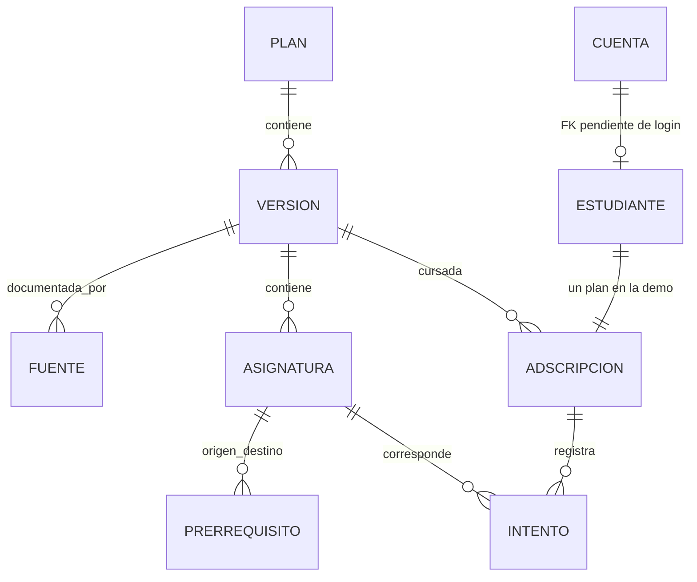

# Catálogo y progreso académico

Implementación del 11 de octubre de 2026 para HU09-T03 y la ampliación autorizada de perfiles/progreso. Esta entrega es una base de backend: no implementa login, pantallas, simulación ni importación institucional. Leer junto al [SDD](../AGENTS/SDD.md) y las [fichas del sprint](HISTORIAS-USUARIO-INVEST.md).

## Fuentes y decisiones

El equipo confirmó que [la imagen](Foto%20prerequisitos%20Nutricion.jpeg) corresponde al plan 2027 y que sus flechas representan prerrequisitos oficiales. Es confirmación del equipo, no validación independiente del cliente. La imagen manda para nombres y SCT; [el PDF](malla-nutricion-y-dietetica-2027.pdf) es complementario. Los hashes SHA-256 y la fecha de revisión están en `catalogs/academic/nutricion-2027-r1.json`. `teamReviewed` describe la referencia/documento, no certifica que cada flecha haya sido interpretada y cotejada por otro revisor.

Se transcriben 52 asignaturas, 305 SCT y 35 flechas observadas. Los primeros ocho semestres tienen 30 SCT cada uno; el bloque IX–X tiene 65. No se duplican internados ni se reparten sus créditos entre semestres. Los códigos `NUT2027-001` a `NUT2027-052` son internos; `officialCode` permanece `null`. Mantener esos códigos aunque se cambie el orden visual.

El PDF abrevia algunos nombres: por ejemplo, «Introducción a la Salud Pública» frente a «Introducción a los determinantes sociales de la salud y salud pública» en la foto. No mezclar nombres de ambas fuentes silenciosamente. El PDF indica rotaciones paralelas para IX–X; el modelo conserva el intervalo sin asignar una secuencia institucional.

**Revisión pendiente de HU10:** cotejar origen/destino de las 35 flechas; revisar especialmente las ramas entre Bases bioquímicas/Análisis alimentario, Nutrición básica/Diagnóstico nutricional y Planificación alimentaria/Dietética, y las líneas que llegan a los internados. Los cruces dudosos no se añadieron como relaciones confirmadas. Confirmar si varias entradas significan AND/OR y si un ramo sin flechas carece realmente de requisitos. Los resaltados amarillos no se interpretan como una regla adicional.

Todas las expresiones actuales usan `kind: pending`; cada flecha conserva `interpretation: pending` y su fuente. Esto permite visualizar relaciones observadas, **no presentar el catálogo como un conjunto completo de reglas interpretadas**. `none` requiere confirmación explícita. `allOf`/`anyOf` se conservan como formas de contrato, sin evaluar habilitación ni simular progreso. Corregir una versión publicada requiere crear otra versión (`2027-r2`, etc.).

## Persistencia

Tablas desplegables: `cenit.academic_plans`, `academic_versions`, `academic_sources`, `academic_courses`, `academic_prerequisite_edges`. Plan/versión únicos, códigos/orden únicos por versión, FK de flechas hacia cursos y fuentes de la misma versión. SCT en `numeric(6,2)`; semestres 1–20 y final mayor o igual al inicial.

Dos migraciones versionadas: catálogo y guards de publicación. El importador valida TypeBox, referencias, profundidad/hojas y ciclos antes de abrir la transacción. La publicación también rechaza ciclos en el grafo relacional. Los triggers bloquean cambios en cursos, fuentes, flechas, versión y nombre del plan publicado; bloquear la fila de versión impide carreras entre publicación y cambios de sus hijos. La carga usa transacción y advisory lock por plan/versión; repetir el mismo contenido no lo duplica. Otro contenido para el mismo identificador se rechaza. No modificar SQL ya integrado/aplicado; generar migraciones posteriores.

El migrador usa el lector de archivos/journal de Drizzle y un ledger compatible en `cenit.__drizzle_migrations`, con transacción, lock y comprobación de hashes/timestamps ya aplicados. El esquema `cenit` debe estar preparado por infraestructura: no ejecuta `CREATE SCHEMA`, que exige CREATE de base incluso con IF NOT EXISTS. Se ensaya sin ese permiso ni superusuario, conforme a la VM; no ampliar el rol para resolverlo. Rechaza historia alterada o una base más adelantada que el artefacto.

Las relaciones propuestas para historial son:



`db/schema/academic-progress.ts` y `db/pending/academic-progress.sql` son una **propuesta no desplegada**, fuera de `drizzle.config.ts` y del journal. Necesitan la tabla/columna de cuentas revisada por HU01-T03. La propuesta usa FK UUID; si login elige otra clave, adaptar antes de integrar. No ejecutar el SQL con marcadores ni registrar un UUID huérfano sin FK. El test sustituye los marcadores por una tabla sin credenciales dentro de una base descartable, exclusivamente para verificar constraints y API.

Historial propuesto: cuenta única por estudiante, RUT textual conservado, adscripción única a una versión para la demo, intentos numerados únicos por adscripción/asignatura, una sola inscripción en curso y FK compuestas para impedir mezcla de versiones. No se añaden períodos académicos oficiales, asignaciones docente-estudiante ni tablas de simulación.

Estados: `passed`, `failed`, `inProgress`; `notTaken` se deriva de ausencia de filas. Nota `numeric` entre 1 y 7, con CHECK que exige como máximo un decimal significativo: aprobado desde 4, reprobado bajo 4, en curso con `null`, sólo para los datos ficticios acordados. No usar coerción de escala para redondear valores de mayor precisión silenciosamente. La respuesta muestra el estado del último intento, todos los intentos ordenados y la última nota aprobatoria registrada. El conteo incluye el intento en curso. No hay porcentaje ni créditos completados.

## Contrato de lectura y conexión con login/frontend

Schemas y tipos públicos: `@cenit/contracts/academic`; ejemplos compilables: `@cenit/contracts/academic/examples`. No importar modelos Drizzle en el frontend.

| Ruta | Permiso |
| --- | --- |
| `GET /api/v1/academic/plans` | Docente y estudiante |
| `GET /api/v1/academic/plans/:planId/versions/:version` | Docente y estudiante |
| `GET /api/v1/academic/me/progress` | Estudiante; cuenta obtenida de sesión |
| `GET /api/v1/academic/students` | Docente; todos los ficticios de Nutrición |
| `GET /api/v1/academic/students/:studentId/progress` | Docente |

Listado de estudiantes: nombre parcial (ILIKE con comodines escapados), RUT exacto, combinación AND. `page` predeterminado 1 y `pageSize` 20 (máximo 100). RUT: conservar puntuación/case original y usar únicamente para búsqueda una clave sin puntos y con K mayúscula; no inventar validación institucional del dígito verificador. Consultas parametrizadas y snapshot de lectura para conteos/datos coherentes.

Respuestas: `{data: ...}`; lista de estudiantes añade `page`, `pageSize`, `totalItems`. El catálogo conserva los campos previos y añade `semesterEnd`, `codeKind`, `officialCode`, `displayOrder`, `sources`, hashes/fechas y `prerequisiteEdges`. Nuevo caso `pending` en la unión de reglas. Gael debe adaptar el consumidor y su leyenda antes de integrar la pantalla; no hay consumidor frontend implementado en este checkout.

Corrección del líder: las notas JSON son **cadenas con coma y un decimal**, omitiéndolo cuando es cero: `"4,1"`, `"6"`, `"6,5"`, o `null` si no existe nota; los SCT siguen siendo números. PostgreSQL usa su representación numérica interna con punto; el repositorio convierte sólo la presentación. `6.0` se muestra como `6`, sin cambiar su valor. Una nota con más de un decimal significativo se rechaza; no se inventa una política de redondeo. La unión de intentos distingue nota aprobatoria, reprobatoria y ausencia de nota en curso. Frontend/login deben consumir este contrato corregido, no la propuesta anterior de dos posiciones.

Errores públicos `{error:{code,message,requestId}}` y header `X-Request-Id`: 400 `VALIDATION_ERROR`, 401 `AUTHENTICATION_REQUIRED`, 403 `FORBIDDEN`, 404 `NOT_FOUND`, 503 `SERVICE_UNAVAILABLE` y 500 `INTERNAL_ERROR`; sin SQL, configuración privada ni trazas. Cache-Control `no-store` en las respuestas. No hay rutas de escritura.

El plugin recibe `authenticate(request)` desde login y espera `{accountId,role}` obtenido del servidor. No analiza tokens ni acepta rol/identidad del body, headers o query por sí mismo. Sin adaptador devuelve 401. Los Bearer de prueba sólo existen en el harness de integración; no son cuentas reales ni una implementación de autenticación. Roles administrativos rechazados; docente no usa `/me/progress`, estudiante no lista ni consulta otros estudiantes. Progreso sin migración vinculada produce 503.

## Comandos

Usar Node **24.21.0** y npm **11.19.0**, fijados en `.node-version`/manifiesto. Esta entrega inicializa sólo `apps/api` y `packages/contracts`; Gael conserva la inicialización/versiones de `apps/web`.

```powershell
npm ci
npm run typecheck
npm run catalog:check
npm run test:unit
npm run test:integration
npm run build:academic
```

Integración requiere PostgreSQL 17 accesible con permiso para crear **bases y roles exclusivos de prueba**. Localmente usa la contraseña privada de `.local/secrets/postgres-password` y loopback 55432. Para otro puerto/servidor, guardar una URL administrativa en un archivo privado y configurar `ACADEMIC_TEST_ADMIN_URL_FILE`; en CI usa `DATABASE_URL` del servicio descartable. Nunca usar una credencial administrativa en el runtime. Cada ensayo crea dos bases `cenit_academic_test_<hex>_*`, roles sin privilegios elevados, y elimina únicamente sus recursos generados. No borra ni aplica semillas en `cenit_demo`.

Aplicar sólo las migraciones del catálogo en la base de demo, de forma explícita:

```powershell
$env:DATABASE_URL_FILE = '<ruta privada a la URL de cenit_migrator>'
npm run db:migrate
$env:APP_ENV = 'demo'
npm run catalog:load
```

Las URL generadas por Compose contienen el hostname `db`, válido dentro de sus contenedores. Para ejecutar estos comandos desde Windows, preparar un archivo privado con el host `127.0.0.1` y puerto local (55432 por defecto), conservando credencial/base; no imprimirlo ni versionarlo. Las migraciones no cargan catálogo, cuentas ni historiales. `catalog:load` comprueba hashes de fuentes y no crea estudiantes. `db/seeds/academic-demo.ts` está preparado para una carga explícita posterior con cuentas existentes; no tiene CLI mientras la FK siga pendiente.

Actualización del 11 de octubre: `npm run dev --workspace @cenit/api` conecta la sesión local real de [AUTENTICACION.md](AUTENTICACION.md), con credencial runtime. Docente/estudiante autenticados pueden leer el catálogo; sin sesión, 401; administrativo, 403. `/health/ready` permanece en 503 porque falta frontend/build completo. No activar el proxy definitivo ni releases. `cenit.accounts.id` ya define identidad UUID; la migración académica de perfiles/historial sigue fuera del journal para su revisión/integración separada.

## Verificación y seguimiento

Se ejecutaron typecheck, build académico, comprobación del catálogo, 28 unitarias y 38 pruebas PostgreSQL/API, además de 39 pruebas de infraestructura y actionlint. Las pruebas usan el migrador real de despliegue dos veces, bases sin tablas de negocio/con tabla previa (esquema preaprovisionado como en la VM), roles limitados, inmutabilidad, carga concurrente, referencias, ciclos, semestres, notas, rollback, búsqueda y permisos. El catálogo también se migró/cargó explícitamente en `cenit_demo` local y se leyó como `cenit_app`: 52 asignaturas, una versión publicada y ninguna tabla de historial. La ejecución del workflow en GitHub y la revisión del equipo siguen pendientes; no se modificó la VM.

CI distingue explícitamente `cenitStage: academic-foundation`: sólo `develop` admite esta entrega parcial, exige el job académico y mantiene la aplicación completa omitida. `main` y release permanecen bloqueados. Al integrar frontend/login, retirar ese marcador, incluir `apps/web`, completar scripts reales de lint/build/E2E y pasar el CI completo. No añadir scripts que siempre pasan para satisfacer el gate.

Dependencias nuevas: Fastify adapta HTTP; pg conecta PostgreSQL; Drizzle define/genera/migra el esquema; TypeBox comparte contratos; TypeScript, tsx y Vitest permiten compilar/cargar/verificar. Versiones exactas y lockfile único. Vitest 4.1.11 incluye la corrección de su mocker; override de esbuild 0.28.2 elimina la dependencia vulnerable del generador estable de Drizzle. Se verificó generación/check de Drizzle, build y tests con ese override; no se adoptaron betas ni versiones RC.
