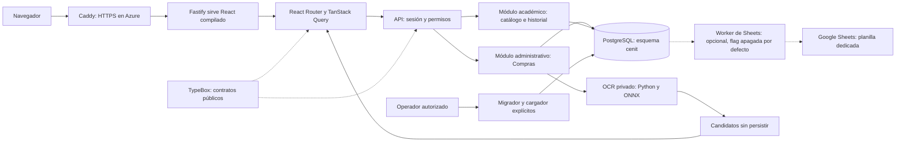
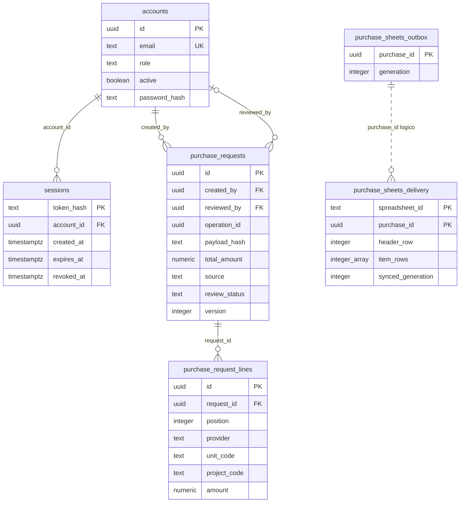

# Diseño de software (SDD): arquitectura y funcionamiento de Cenit

Cenit organiza información administrativa y facilita la consulta académica de Nutrición y Dietética en la Facultad de Medicina de la Universidad Católica del Norte, sede Coquimbo. Este documento explica la solución existente, sus límites y los asuntos que aún requieren definición. La instalación se describe en las [guías de operación](../deploy/LOCAL.md) y las comprobaciones en [Pruebas y criterios de aceptación](PRUEBAS-Y-ACEPTACION.md).

Este archivo es el SDD vigente del repositorio. README es el punto de entrada; `deploy` conserva los procedimientos de operación. No se mantiene otra copia del diseño con decisiones diferentes. Los diagramas siguientes son Mermaid editable en Markdown, revisable junto con el código.

## Estado de la implementación

«Implementado» identifica comportamiento disponible en el código con pruebas enlazadas; «preparado» identifica una herramienta o configuración que requiere ejecución explícita en un destino; «pendiente» identifica definición, validación o comprobación que todavía no se acredita. Ninguno de esos estados sustituye la aceptación del cliente ni confirma qué SHA está instalado actualmente en Azure.

| Área | Implementado | Preparado o pendiente |
| --- | --- | --- |
| Plataforma | Login local y Google opcional con vinculación explícita, rol por cuenta, sesión de dos horas, frontend compilado servido por API, PostgreSQL persistente | Acceso Google administrativo y foto comprobados en la demo local; configuración, recorrido y aceptación del destino elegido pendientes |
| Administrativo | Compras: captura, revisión, alta manual, persistencia, búsqueda, resumen, validación local, eliminación y descarga Excel de las coincidencias | Copia opcional a Google Sheets, apagada por defecto y sin conector real comprobado con una planilla dedicada; precisión OCR acordada con nuevas muestras; actualización de una copia desde otra captura |
| Académico | Consulta por rol, versiones del catálogo, detalle, reglas simples/conjuntas e historiales ficticios | Carga explícita de `diagrama-r2` en cada entorno; año, códigos y aceptación institucional pendientes |
| Personal | Entrada con dos tarjetas grandes, que ocupan todo el alto disponible y muestran la parte superior de cada documento, grande e inclinado, con márgenes y hojas decorativas detrás (con efecto al pasar el cursor), para elegir. Cada documento ofrece «Cambiar de documento» y una ruta superior «Administración › Personal › documento» para volver; con datos sin completar se pide confirmar antes de salir. Comisión de servicios y Solicitud de permiso: formulario por secciones, búsqueda de funcionario ficticio, vista previa aproximada y PDF carta generado por el servidor; borrador sólo en memoria | Validaciones y formato pendientes de confirmación institucional y revisión del recorrido integrado |
| Bienes | Propuesta general: inventario con búsqueda por palabras clave, ficha con historial, alta adaptada al tipo de bien, entregas y préstamos con PDF carta para firmar, devoluciones, cambios de ubicación y responsables (con «ya no pertenece» y entrega de todos sus bienes). Código Cenit `BN-0001`; N° de inventario opcional. Datos ficticios en la demo local | Identificador oficial, inventario maestro, firmantes, fecha de devolución, permisos y formato de los documentos pendientes de validar con la Facultad |
| Entregas en ramas | Backend e interfaz Google integrados en `develop` mediante el PR #70 | Google requiere revisión independiente y comprobación de la entrega y configuración en Azure. Los respaldos cifrados con copia fuera de la VM y las mejoras OCR se revisan en sus ramas correspondientes |
| Entrega | CI, imágenes por digest, despliegue Azure, migrador separado y recuperación de configuración ante fallos de activación | Catálogo/cuentas se preparan por separado; restauración completa de datos y retiro del servidor anterior requieren ensayo y aprobación |

La [matriz de aceptación](PRUEBAS-Y-ACEPTACION.md) identifica pruebas y evidencia histórica. El estado operativo se obtiene de Actions, `current.json`, health y recorridos autenticados, siguiendo la [guía Azure](../deploy/azure/README.md#diagnóstico-y-recuperación).

## Alcance y entregas

El Project Charter contempla una plataforma modular con Compras, Personal, Bienes y consulta académica. La primera entrega se concentra en Compras y académico. Personal y Bienes forman parte del proyecto completo, pero sus campos, operaciones y reglas deben validarse antes de implementarlos. Personal ofrece por ahora dos documentos, que se eligen en `/administracion/personal`: la Comisión de servicios (`/administracion/personal/comision`) y la Solicitud de permiso (`/administracion/personal/permiso`). En ambos el administrativo busca al funcionario, completa el formulario y descarga un PDF de una hoja carta para imprimir; las firmas se gestionan fuera de Cenit y no se guarda ningún documento. Bienes ofrece una propuesta general en `/administracion/bienes`, descrita en [Bienes: propuesta general](#bienes-propuesta-general); sus campos y reglas siguen pendientes de validación.

La búsqueda de funcionarios sugiere personas de ejemplo e indica bajo el campo que también se puede escribir el nombre; la condición de propuesta se conserva en la marca «BORRADOR» de la vista previa y del PDF. La vista previa permite revisar los datos incompletos sobre el formato de la hoja `COMISION` del XLSM; es aproximada y conserva controles y desplazamiento accesibles por teclado. La plantilla excluye valores del ejemplo, nombres de firmantes, fórmulas y macros. Las tarjetas y la vista previa reservan las dimensiones de cada plantilla antes de descargarla. Durante la espera muestran la silueta de la hoja en el mismo lugar.

Descargar e imprimir envían los datos al servidor y esperan el PDF de una página carta antes de iniciar la salida. Durante la preparación, «Cancelar» ocupa el lugar de la otra acción y la barra conserva su tamaño. La impresión abre ese mismo PDF en el visor del navegador; su diálogo y resultado dependen del navegador e impresora. Si el visor no carga, se informa el fallo y se ofrece descargar el archivo para imprimirlo. El borrador vive sólo en memoria. La pantalla evita solicitudes simultáneas, permite cancelar y cancela una respuesta pendiente al editar el formulario, confirmar la salida, cerrar la sesión o perderla. Un error de conexión o de validación conserva los datos mientras la sesión siga vigente; los errores de campo vuelven a su sección y enfocan el primero. El documento conserva los espacios de firma vacíos y lleva «BORRADOR».

Carta es una propuesta para validar con el cliente: Excel mostró la hoja recibida en carta, vertical y ajustada a una página de ancho por una de alto, aunque el XLSM no declara el tamaño de papel en sus metadatos. La plantilla usa la fuente disponible durante su conversión y el servidor usa Times Roman para los valores; la vista previa puede diferir de la salida. El servidor rechaza los textos que no caben o incluyen caracteres no admitidos, sin recortarlos. El formato, la legibilidad y la impresión siguen pendientes de validación institucional.

### Bienes: propuesta general

Basada en el informe de levantamiento del módulo y en los formularios de alta (Sección Registro), entrega y préstamo transitorio. Es una implementación general para validar con la Facultad; no reemplaza el registro institucional de la Sección Registro.

- **Inventario** (`/administracion/bienes`): búsqueda por código, N° de inventario, serie, descripción, marca, modelo, material, ubicación y responsable, tras 250 ms; filtros por tipo y estado en la URL. Las cifras superiores llevan a cada vista. El estado se calcula: préstamo vencido, en préstamo, por revisar (responsable que ya no pertenece), asignado o sin responsable. «Por revisar» cuenta y filtra todo bien cuyo responsable ya no pertenece, aunque siga prestado; en ese caso la fila conserva el estado «En préstamo» y marca al responsable.
- **Ficha** (`/administracion/bienes/:id`): datos según tipo, situación actual (responsable, ubicación y préstamo vigente) e historial con cada movimiento y su documento. El responsable cambia sólo con una entrega y la ubicación con una entrega o un cambio de ubicación; ambos quedan en el historial. La edición de datos usa versión esperada.
- **Alta** (`/administracion/bienes/nuevo`): los campos siguen la Nota 2 del formulario (marca/modelo/serie, tipo/material/medidas o m²/materiales). El N° de inventario es opcional y queda vacío si no se conoce. Puede asociarse una compra registrada en Cenit por su número. El formulario de alta se descarga desde la ficha.
- **Entregas** (`/administracion/bienes/entregas`): varios bienes por acta, incluso uno que no estaba en el inventario (se registra al guardar). Quien recibe pasa a ser responsable; la ubicación cambia sólo si se indica. No se entrega un bien en préstamo.
- **Préstamos** (`/administracion/bienes/prestamos`): devolución esperada opcional; vencido cuando pasa esa fecha en America/Santiago. El responsable no cambia. La devolución se registra junto a su botón.
- **Responsables** (`/administracion/bienes/responsables`): personas ficticias en la demo; se agregan también desde entregas y préstamos. Marcar que alguien ya no pertenece deja sus bienes por revisar y ofrece «Entregar sus bienes», que carga hasta diez de los no prestados en una entrega (el máximo de un acta); si quedan más, lo indica para repetir la operación, y si hay bienes en préstamo avisa que primero se registra su devolución.

Entregas y préstamos usan folio correlativo por año (`008/2026`) asignado al guardar, guardado atómico y reintento idempotente por `operationId`. Los PDF carta se generan en el servidor desde lo guardado; en el préstamo, la fila «DATOS» indica el tipo de los bienes prestados, como pide el formulario. Llevan firmas vacías, la marca «BORRADOR» y una nota de formato pendiente; Cenit no guarda el papel firmado. Un acta o préstamo admite hasta diez bienes para caber en una hoja; si aun así el contenido no cabe, el servidor responde 422 con un mensaje en lugar de entregar un PDF recortado, y los caracteres que la fuente no admite (✓, ≥, emoji) se rechazan al guardar o al generar el PDF, nunca se imprimen como «?». Las fechas que no existen en el calendario (31/02) también reciben 422.

El encabezado común de Bienes indica que el módulo no reemplaza el registro de la Sección Registro; los documentos conservan «BORRADOR» y la nota de formato pendiente. En los formularios, los errores aparecen en rojo bajo cada campo, el aviso superior indica cuántos datos faltan y el foco pasa al primero. Dos préstamos simultáneos del mismo bien no se duplican: el segundo recibe 409 tras esperar el bloqueo de la fila del bien. `GET/POST /api/v1/assets…` exige sesión administrativa y, para escribir, `Origin` permitido.

### Comisión de servicios: correspondencia provisional

La siguiente correspondencia describe la propuesta de pantalla y PDF para SCRUM-101 y SCRUM-108. Sus obligaciones y validaciones son una propuesta, no una confirmación institucional. Las coordenadas son las celdas de la hoja `COMISION` de la plantilla recibida; el código de presentación las sitúa en la imagen. No se copian los datos ni las fórmulas del ejemplo.

| Entrada de la pantalla | Validación actual de la propuesta | Celda o sección del documento |
| --- | --- | --- |
| Nombre, cargo y unidad | Texto obligatorio | E11, E13, E15 |
| Grupo | Selección obligatoria I, II o III | F17, M17, U17 |
| Estamento y detalle de otro | Selección obligatoria; el detalle es obligatorio sólo para «otro» | E19, K19, E21, R21 y V21 |
| Planta | Una selección obligatoria | E23, M23 y R23 |
| Territorio y lugar | Selección y lugar obligatorios | E25/P25 para nacional; E27/P27 para extranjero |
| Fechas de inicio y término | Fechas válidas obligatorias; término no anterior al inicio | G29 y P29 |
| Días con y sin pernoctación; total | Los dos primeros son opcionales y enteros si se ingresan; el total se ingresa manualmente y admite medio día | I31, O31 y Y31 |
| Viático y moneda | Importe opcional; si se ingresa, exige moneda | F33 y T33 |
| Institución, organización, unidad, proyecto y porcentaje | Primera fila obligatoria; segunda opcional, pero completa si se usa. Los códigos admiten dígitos y el porcentaje debe ser mayor que cero y no superar 100 | E35/H35/K35/R35/AA35 y E37/H37/K37/R37/AA37 |
| Evento, organizador, trabajo, proyecto y observaciones | Para la opción evento, nombre y organizador son obligatorios; los otros son opcionales | E41, E43, E45, E47 y E49 |
| Descripción de la comisión | Obligatoria al elegir descripción en lugar de evento | B54 |

La propuesta no calcula viáticos, total de días ni suma de porcentajes; tampoco determina firmantes. Los tres espacios de firma permanecen vacíos y el documento lleva «BORRADOR». Deben confirmarse con la contraparte la obligatoriedad, los cálculos, la coexistencia de evento y descripción, las firmas y el formato. La pantalla conserva las entradas ocultas mientras se edita, pero sólo envía la actividad seleccionada al generador.

`POST /api/v1/personnel/service-commissions/pdf` recibe los campos de `ServiceCommissionSchema` de `@cenit/contracts/personnel`, con todas las propiedades presentes y cadenas vacías para los valores opcionales. Exige sesión administrativa y `Origin` permitido; valida el cuerpo y las reglas provisionales en el servidor, sin guardar los datos ni calcular resultados. Si un campo semánticamente inválido o su texto no cabe en la hoja, responde 422 con `error.fields` por nombre de campo; los errores de estructura reciben 400. Si el contenido contiene caracteres que la fuente del PDF no admite, el campo se rechaza de forma explícita. La respuesta correcta es un PDF carta de una página en memoria, con `Cache-Control: no-store`, marca «BORRADOR» y firmas vacías. El generador usa la plantilla vectorial derivada del SVG sin datos de ejemplo y la fuente estándar Times Roman para los valores; si cambia la plantilla, regenerar `apps/api/assets/service-commission-template.pdf` con `rsvg-convert --format=pdf --output=apps/api/assets/service-commission-template.pdf apps/web/src/features/personnel/components/commission-template.svg` y volver a cotejarla visualmente; el formato final y la equivalencia visual con la vista previa requieren revisión. La pantalla interpreta los errores de campo y conserva el borrador ante fallos de la generación.

### Solicitud de permiso: correspondencia provisional

La propuesta parte de la hoja `SOL. PERMISO` del XLSX recibido («FORMULARIO SP - 1»), que no tiene fórmulas, listas de validación ni macros. La plantilla conserva sus rótulos, las casillas, los tres espacios de firma, la sección de uso exclusivo de RRHH/DAF y la nota de instrucciones; excluye los valores del ejemplo. Las obligaciones son una propuesta, no una confirmación institucional: siguen pendientes de confirmar con la contraparte la obligatoriedad por tipo, el cálculo de días, el orden de las firmas, la vigencia del formulario y el formato.

| Entrada de la pantalla | Validación actual de la propuesta | Celda del documento |
| --- | --- | --- |
| Fecha de la solicitud | Fecha válida obligatoria; propone la fecha del día | U5, V5 y W5 (día, mes y año de dos dígitos) |
| Nombre, RUT y unidad | Texto obligatorio; el RUT debe tener dígito verificador correcto | D8, U8 y D10 |
| Tipo de permiso | Una selección obligatoria entre los 14 tipos de la hoja | Casillas D19–D31 (columna izquierda) y M19–M31 (derecha) |
| Desde y hasta | Fechas válidas obligatorias; término no anterior al inicio | F12/G12/H12 y M12/N12/P12 (día, mes y año) |
| Total de días | Opcional; si se ingresa, número o medio día. No se calcula | V12 |
| Horas y minutos, desde y hasta las, fecha de recuperación | Sólo para «Por hora»: todos obligatorios, minutos hasta 59 y término posterior al inicio. Con otro tipo no se envían | D15, F15, M14, V14 y G17/H17/I17 |
| Observaciones | Opcional | D33 |

Cenit no marca «Procede/No procede», no asigna número ni control de días y no aplica las reglas de la nota (anticipación, feriados, recuperación). La revisión recuerda que, según el formulario, el VºBº del VAEA o VR de sede corresponde sólo a permisos sin goce de sueldo; los tres espacios de firma se imprimen vacíos. El tamaño de papel no figura en el XLSX; se usa carta como en la comisión.

`POST /api/v1/personnel/leave-requests/pdf` recibe `LeaveRequestSchema` de `@cenit/contracts/personnel` con las mismas reglas de acceso, errores (`PersonnelPdfErrorsSchema`), rechazo de textos que no caben y respuesta `no-store` que el endpoint de comisión. Los valores usan Helvetica, cercana al Arial de la hoja. Si cambia la plantilla, regenerar `apps/api/assets/leave-request-template.pdf` con `rsvg-convert --format=pdf --output=apps/api/assets/leave-request-template.pdf apps/web/src/features/personnel/components/leave-template.svg`; la geometría de las casillas está en `leave-layout.ts` (web y API, comparada por una prueba).

Compras recupera datos de capturas de compras aprobadas previamente en Oracle, permite revisarlos y conserva una copia consultable. Cenit no se conecta a la API de Oracle, no crea ni modifica compras allí y no ejecuta aprobaciones o pagos institucionales. La revisión local, la situación de pago declarada y la aprobación institucional son conceptos diferentes.

El componente académico muestra la malla, las relaciones curriculares recibidas y el avance de estudiantes ficticios. Una relación observada no se transforma en una regla oficial sin cotejo. Se mantienen identificados los prerrequisitos pendientes.

El Charter sitúa el desarrollo entre agosto y diciembre de 2026, con cierre estimado el 11 de diciembre. Esa planificación no acredita que una funcionalidad esté entregada o aceptada. La aceptación requiere pruebas y revisión con los responsables administrativos o académicos. Jira conserva el backlog, las asignaciones y los criterios de cada tarea; este documento resume el funcionamiento y las decisiones técnicas que necesita conocer quien mantiene el sistema.

Quedan fuera del MVP la autenticación institucional por dominio y la simulación académica. La iteración de identidad incorpora Google como alternativa opcional para cuentas exactas previamente autorizadas y vinculadas a cuentas locales; no acredita una integración institucional UCN. La iteración de registro incorpora una integración opcional Cenit → Google Sheets, desactivada por defecto; amplía la base del Charter que dejaba Sheets como mejora opcional y requiere coordinación documental de ese alcance. El Charter también excluye simulaciones e integración con la API de Oracle del alcance descrito. No se incorporan procesos de Banner, importación masiva ni nuevos flujos institucionales por inferencia. El uso de datos reales requiere autorización de sus fuentes y acuerdos específicos; los datos ficticios no acreditan esas condiciones.

## Organización del código

Cenit es un monolito modular. El navegador consume un API REST JSON bajo `/api/v1`; PostgreSQL guarda los datos. En producción, Fastify sirve también el frontend compilado, de modo que la web y el API comparten origen. En desarrollo, Vite sirve la web y dirige las llamadas al API local.

La cresta de Doña Ana identifica a Cenit en la pestaña del navegador, en la pantalla de acceso y junto al nombre en la navegación lateral de Administración y Académico.

| Ubicación | Responsabilidad |
| --- | --- |
| `apps/web/src/app` | Rutas, proveedores, navegación y composición de la interfaz |
| `apps/web/src/features/auth`, `purchases`, `academic` | Pantallas, consultas y presentación de cada funcionalidad |
| `apps/web/src/shared` | Componentes y utilidades que realmente comparten varias funcionalidades |
| `apps/api/src/modules/auth`, `purchases`, `academic` | Rutas, servicios y repositorios de cada módulo |
| `apps/api/src/infrastructure` | Conexión a PostgreSQL, errores, configuración, salud y servicio del frontend |
| `apps/ocr` | Procesamiento auxiliar de imágenes; no guarda compras ni consulta la base |
| `packages/contracts` | Schemas TypeBox/JSON Schema, tipos y formatos públicos del API |
| `db/schema`, `db/migrations` | Modelo Drizzle e historial de cambios de PostgreSQL |
| `db/seeds` | Preparación explícita de datos ficticios y catálogo |
| `catalogs/academic` | Catálogo versionado y referencias a sus fuentes |
| `tests/integration`, `tests/e2e`, `tests/infrastructure`, `tests/ocr` | Pruebas de persistencia/API, navegador, operación y procesamiento |
| `deploy` | Configuración local, Azure y herramientas de la instalación anterior |
| `experiments` | Investigación reproducible separada de la aplicación |

Las rutas adaptan HTTP; los servicios aplican las reglas; los repositorios realizan las consultas. Cada módulo controla su persistencia y evita acceder a estructuras privadas de otro módulo. El frontend comparte contratos públicos con el servidor, no tablas Drizzle ni modelos internos.

### Componentes y límites

El navegador vuelve al mismo origen para consultar `/api/v1`; las flechas representan dependencias, no servicios frontend desplegados por separado. Administrativo accede a Compras; docente y estudiante acceden a académico, con restricciones diferentes para historiales. PostgreSQL se usa con `cenit_app` desde la aplicación y `cenit_migrator` desde herramientas separadas. OCR no recibe credenciales PostgreSQL. La revisión humana y el POST explícito separan extracción de guardado. Las flechas punteadas hacia Sheets son opcionales: sólo existen con `CENIT_PURCHASE_SHEETS_SYNC_ENABLED=true`, leen la cola de PostgreSQL de forma asíncrona y no condicionan el guardado local, que no depende de la disponibilidad de Google ([detalle](#copia-automática-en-google-sheets)).

En Azure cada entorno tiene su red, contenedores, volumen y secretos independientes, pero comparte la VM y sus recursos físicos. En local Nginx sustituye la entrada Caddy; en desarrollo Vite sirve React y hace proxy al API. Esas variantes y sus puertos están en [Entorno local](../deploy/LOCAL.md#configuración-del-runtime-y-puertos).

Se mantiene React, Vite, TypeScript, React Router, TanStack Query, Tailwind y los componentes seleccionados de shadcn/Radix. El API usa Node.js 24 LTS, Fastify 5, PostgreSQL 17 y Drizzle. Las versiones exactas están en los manifiestos, el único `package-lock.json`, `.node-version` y `deploy/images.lock.json`; no se duplican aquí. REST y las versiones concretas son la base técnica del repositorio, sin atribuirles ratificación institucional. No se añaden microservicios, GraphQL ni abstracciones generales sin una necesidad y decisión documentadas.

Los tests unitarios se colocan junto al código. Los escenarios con PostgreSQL pertenecen a integración; los recorridos de personas, a E2E. Las muestras de OCR y sus valores esperados permanecen separados del extractor. Los datos de PostgreSQL, secretos, capturas de ejecución y compilados no se versionan.

## Autenticación y sesión

El acceso local usa correo y contraseña. La pantalla muestra el mismo formulario durante la comprobación inicial de la sesión y habilita sus controles cuando el servidor confirma que se necesita iniciar sesión. Los mensajes de error tienen espacio reservado para mantener los campos y las acciones en su posición. El cierre confirmado se avisa con una notificación verde «Saliste de Cenit» y el vencimiento o una sesión inválida con una notificación amarilla «Tu sesión expiró», ambas en la esquina inferior derecha; la amarilla permanece hasta cerrarla o volver a entrar. Google es una alternativa opcional, desactivada por defecto, para cuentas autorizadas explícitamente. Su interfaz consulta la disponibilidad del servidor y ofrece vinculación desde la navegación de los tres roles. El acceso Google administrativo y la foto se comprobaron con un cliente real en la demo local. Cada destino requiere su propia configuración y comprobación explícitas. Cada cuenta tiene un rol; el login no acepta asignación de rol desde el navegador. No hay registro público ni recuperación de contraseña.

| Recurso | Acceso |
| --- | --- |
| Compras, extracción, resumen, validación y eliminación | Administrativo |
| Catálogo académico | Docente y estudiante |
| Historial propio `/academic/me/progress` | Estudiante; identidad obtenida de la sesión |
| Búsqueda de estudiantes e historial por identificador | Docente; estudiantes ficticios de Nutrición en la demo |

Los permisos se aplican en el servidor incluso si se consulta el API directamente. Sin sesión se rechaza el acceso; enviar identidad o rol por headers no concede permisos.

Las contraseñas se guardan con scrypt y salt; los tokens de sesión son aleatorios y la base conserva sólo su digest. La cookie `cenit_session` es HttpOnly, SameSite=Lax y Secure por defecto. La sesión dura dos horas fijas desde el login y no se renueva al consultar. Logout revoca la sesión. El rol y la activación de la cuenta se comprueban en el servidor.

Rutas de acceso: `POST /api/v1/auth/login`, `GET /api/v1/auth/session` y `POST /api/v1/auth/logout`. Login y logout requieren un Origin exacto autorizado. El login limita diez intentos por minuto/IP. La excepción de cookie sin Secure se admite sólo con configuración explícita de desarrollo, test o demo HTTP; no es la configuración por defecto de una instalación institucional.

### Contrato vigente de cierre y expiración — SCRUM-36

`GET /api/v1/auth/session` devuelve la cuenta y `expiresAt` según el [contrato compartido](../packages/contracts/src/auth/index.ts). El servidor fija ese vencimiento al crear la sesión y exige que la hora de consulta sea anterior a él: a las dos horas exactas la sesión deja de ser válida. Consultar, escribir o navegar no amplía el plazo. Una sesión ausente, revocada o vencida devuelve `401 AUTHENTICATION_REQUIRED` en la consulta de sesión y en los recursos que requieren autenticación; borrar la cookie no es el único control de acceso.

`POST /api/v1/auth/logout` recibe `{}`, revoca el token presentado y elimina la cookie; responde `204` sin cuerpo. Repetir el cierre o hacerlo sin cookie también devuelve `204`, con Origin autorizado. Un nuevo login sustituye la sesión anterior presentada por ese navegador, sin invalidar por ello todas las sesiones de la cuenta en otros dispositivos. Las respuestas del API llevan `Cache-Control: no-store`.

Al iniciar el cierre se ocultan los datos protegidos y se limpia la caché de consultas. Sólo tras la respuesta correcta se confirma el cierre en la interfaz. Si falla la petición, se mantiene el contenido oculto, se informa «No se pudo confirmar el cierre de sesión» y se permite reintentar: no se afirma que el servidor haya revocado la sesión. Un formulario modificado permite cancelar la salida antes de iniciar el logout; un guardado pendiente bloquea la salida voluntaria hasta conocer su resultado.

El navegador avisa durante los últimos cinco minutos y, al alcanzar `expiresAt` o recibir un `401` de sesión inválida, solicita volver a iniciar sesión. Descarta los borradores y evita restaurar la identidad anterior mediante respuestas tardías o al volver atrás. Un fallo temporal de comprobación oculta el contenido y permite recuperar el borrador únicamente al revalidar la misma cuenta antes del vencimiento original. El detalle del descarte y la recuperación está en [Interfaz y borradores](#interfaz-y-borradores).

Un guardado sólo muestra éxito después de una respuesta correcta del servidor y mientras su formulario siga activo. Un error, un `401` o perder la sesión no se transforma en confirmación de guardado. Tampoco deshace operaciones ya aceptadas por el servidor: si se pierde la respuesta, el alta mantiene su `operationId` para reintentar mientras el borrador siga vigente, según el contrato de compras.

El cotejo del contrato usa [las pruebas de API](../tests/integration/auth.test.ts) para SCRUM-109 —límite exacto de dos horas, lectura sin renovación, revocación, repetición del cierre y sustitución de sesión— y [las pruebas de pantalla](../tests/e2e/auth.spec.ts) para SCRUM-40 —aviso, vencimiento, fallo/reintento de logout, atrás y cambio de cuenta—. Los casos de [borradores y guardado](../tests/e2e/ux.spec.ts) y [captura](../tests/e2e/capture.spec.ts) complementan el aislamiento. La [matriz de aceptación](PRUEBAS-Y-ACEPTACION.md#acceso-y-sesiones) mantiene los resultados y las revisiones pendientes.

### Acceso opcional con Google

El bloque de usuario del menú lateral abre **Mi perfil**, en `/administracion/perfil` o `/academico/perfil`, y muestra un engranaje de configuración. Esa página reúne nombre, correo local, rol y estado de vinculación Google. La foto del bloque y la del perfil comparten la misma consulta por cuenta y su componente de avatar, con inicial cuando falla la imagen. `GET /api/v1/auth/profile` exige sesión vigente y consulta exclusivamente la cuenta de esa sesión. Los datos del perfil se limpian con la misma caché de autenticación al salir, vencer o cambiar de cuenta. La vinculación se realiza desde el perfil, después de un acceso local.

La migración aditiva `0011_google_profile_picture` incorpora `picture_url` nullable a `google_identities`. La dirección procede del claim `picture` de un ID token verificado, se actualiza al vincular o ingresar con Google y admite únicamente HTTPS en `googleusercontent.com` o sus subdominios, hasta 2.048 caracteres. El navegador carga la imagen con `referrerPolicy="no-referrer"`; PostgreSQL conserva su dirección. El perfil usa la inicial cuando falta la foto o falla su carga. Los vínculos anteriores mantienen `null` hasta otro acceso Google. Esta versión contempla la foto de Google; la subida de una imagen propia requiere una definición posterior de almacenamiento.

Los [contratos Google](../packages/contracts/src/auth/google.ts) separan disponibilidad, desafío y presentación de credencial. La [interfaz compartida de acceso y vinculación](../apps/web/src/features/auth/components/GoogleAccess.tsx) los valida antes de mostrar resultados. El backend no registra cuentas, no cambia roles ni vincula por coincidencia de correo. Se solicita únicamente identidad mediante Google Identity Services, sin permisos de Gmail/Drive ni tokens de acceso o refresh almacenados.

| Ruta bajo `/api/v1/auth` | Entrada y resultado |
| --- | --- |
| `GET /google` | `{data:{enabled,clientId}}`; deshabilitado devuelve `false` y `null`, sin consultar Google |
| `POST /google/challenge` | `{purpose:"login"\|"link"}`; devuelve nonce y vencimiento, y cookie de desafío HttpOnly/SameSite=Strict/Secure según entorno |
| `POST /google/login` | `{credential}` con ID token y cookie del desafío; devuelve el mismo `SessionResponse` que el acceso local |
| `GET /google/link` | Sesión Cenit válida; devuelve `{data:{linked:boolean}}` de esa cuenta |
| `POST /google/link` | `{credential}` y desafío de vinculación; exige la misma sesión local autenticada y devuelve `{data:{linked:true}}` |

Todas las escrituras requieren Origin exacto y admiten diez intentos por minuto/IP por ruta. El desafío tiene cinco minutos de vigencia, se liga a la cookie de navegador, propósito y sesión actual, y se consume atómicamente incluso si después falla la credencial. No se reutiliza tras error, cambio de cuenta o éxito. El navegador entrega el nonce a `google.accounts.id.initialize` y presenta el `credential` del callback como JSON mediante fetch con cookies. No se recibe un formulario de redirección de Google ni se transportan tokens en URL. El contrato acepta hasta 16.384 caracteres de credencial y rechaza propiedades adicionales.

`google-auth-library` verifica firma y destinatario con certificados de Google. Cenit verifica también emisor, vencimiento sin aceptar tokens ya expirados, emisión, correo verificado y nonce. El acceso se resuelve por `sub` previamente vinculado y autorización exacta vigente. La consulta y creación de sesión vuelven a comprobar cuenta activa y autorización con locks de PostgreSQL. Se reutilizan tokens aleatorios, hashes, rotación de la sesión anterior, revocación y vencimiento fijo de dos horas. No se infieren dominios institucionales ni permisos desde claims de Google.

La migración aditiva `0010_google_identity` conserva cuentas/sesiones y añade `authentication_method` con valor inicial `local`, `google_authorizations` (cuenta FK y correo autorizado único), `google_identities` (cuenta FK y sub únicos) y `google_challenges` (hashes de cookie/nonce, propósito, cuenta/sesión vinculadas y fechas restringidas). Cada cuenta admite una identidad Google, sin reemplazo automático. La lista se prepara explícitamente mediante un archivo privado con [el procedimiento operativo](../deploy/LOCAL.md#acceso-google-opcional). La revocación conserva la asociación por sub e invalida las sesiones Google de la cuenta, sin alterar sus sesiones locales. Ni migraciones, arranque ni CD autorizan cuentas automáticamente.

Los errores usan el envelope común y `requestId`: estructura `400`, credencial/desafío inválidos o sesión local requerida `401`, Origin/autorización `403`, identidad o cuenta ya vinculada de otra forma `409`, límite `429`, proveedor deshabilitado o indisponible `503` y fallo inesperado `500`. Todas las respuestas son `no-store`. Una vinculación rechazada conserva la sesión local y su error visible. Ante un `401` del intento de vinculación, la interfaz vuelve a consultar la sesión para distinguir credencial rechazada de sesión vencida. El cliente conserva los desafíos/credenciales sólo durante el intento, permite cancelarlo y descarta callbacks tardíos al cerrar, salir o cambiar de cuenta. El SDK se carga cuando se muestra el acceso habilitado y presenta su botón oficial. Azure dispone de [configuración opcional por entorno y un recorrido de aceptación](../deploy/azure/README.md#habilitar-google-en-un-entorno), cuya ejecución debe acreditarse en el destino.

La pantalla muestra «Iniciar sesión con Google» deshabilitado desde la comprobación inicial. Si el proveedor está apagado o falla la consulta de disponibilidad, el botón sigue visible con un aviso: «El acceso con Google no está habilitado» cuando el servidor lo desactiva y «Google no está disponible en este momento» cuando falla la consulta. Cuando el servidor habilita el acceso, la preparación, la verificación y el botón oficial comparten la misma fila. La interfaz obtiene el nonce automáticamente y el SDK aporta el logo y el texto localizado del botón oficial, que abre Google con una sola acción. La implementación sigue la [verificación oficial de ID tokens](https://developers.google.com/identity/gsi/web/guides/verify-google-id-token) y el [nonce de Google Identity Services](https://developers.google.com/identity/gsi/web/reference/js-reference#nonce). Los comandos y configuración se mantienen en la guía operativa.

### Iteración de jornada pendiente

Existe un diseño para una iteración posterior con ocho horas absolutas y 60 minutos de inactividad para los tres roles. **No está implementado; sigue vigente la sesión fija de dos horas.** El cambio requiere migración aditiva `absolute_expires_at` nullable, contratos compatibles y conservación del vencimiento original de sesiones anteriores.

El diseño prevé `absoluteExpiresAt` opcional y `expiresAt` efectivo, `POST /api/v1/auth/activity` con cookie y Origin, y extensión únicamente de sesiones válidas hasta su límite absoluto. La actividad humana —escritura, clic, scroll y navegación— se agruparía como máximo una vez por minuto; las consultas automáticas y el movimiento del mouse no extenderían la sesión. BroadcastChannel sincronizaría actividad y salida entre pestañas, con revalidación en servidor y sin transportar borradores o credenciales.

La recuperación futura de un borrador tras vencer sería sólo en memoria de la pestaña, para la misma cuenta y operación. Logout explícito, cancelación, recarga, cierre u otra identidad lo descartarían. Su implementación necesita pruebas con relojes controlados, sesiones anteriores, actividad concurrente con logout, respuestas tardías y compatibilidad de la imagen anterior con la migración. Mientras esté pendiente, sigue vigente el comportamiento actual.

## Compras

Una copia tiene una cabecera y de cero a cien ítems. Número, fecha de envío, descripción general y total son obligatorios; los demás datos pueden ser desconocidos y se representan como `null`. Se conservan identificadores, códigos, ceros, referencias y textos originales. Número de documento e identificador Oracle no son únicos mientras no se confirme su identidad y ámbito institucional.

Los montos se almacenan exactamente en PostgreSQL y se intercambian como cadenas de dígitos no negativas, hasta 255 dígitos por campo. No se usa `Number` para calcular o presentar esos montos. No se exige igualdad entre la suma de ítems y el total documental; tampoco se crean imputaciones presupuestarias no confirmadas. La fecha documental es una fecha civil y no se convierte a UTC. Las fechas internas de creación y revisión sí llevan zona horaria.

| Operación | Ruta y comportamiento |
| --- | --- |
| Guardar | `POST /api/v1/purchases`: cabecera e ítems en una transacción; 201 al crear, 200 al repetir la misma operación |
| Listar | `GET /api/v1/purchases`: estado `all`, `pending` o `reviewed`, filtros, página y total documental de coincidencias |
| Exportar | `GET /api/v1/purchases/export.xlsx`: las coincidencias y el mismo orden/filtros del listado, como descarga Excel administrativa. El libro contiene `Resumen`, `Compras` e `Ítems`; los ítems se relacionan con su compra mediante el ID Cenit. Se rechaza con un error comprensible una exportación superior a 10.000 compras y nunca se entrega un archivo parcial. |
| Resumen de Inicio | `GET /api/v1/purchases/summary`: `requests`, `pending`, `currency`, `pendingAmount`, `days` y `overview` (agregados, actividad y altas recientes) |
| Capacidades | `GET /api/v1/purchases/capabilities`: `secondReviewEnabled` y `sheetsSyncEnabled`; requiere sesión administrativa |
| Estado de Sheets | `GET /api/v1/purchases/sheets-sync`, opcional `purchaseId`: estado, cantidad pendiente, último éxito y enlace a la planilla |
| Consultar | `GET /api/v1/purchases/:id`: copia completa y procedencia |
| Corregir copia local | `PUT /api/v1/purchases/:id` con `expectedVersion`: reemplaza cabecera, seguimiento e ítems atómicamente; disponible para registros manuales y desde captura |
| Validar | `POST /api/v1/purchases/:id/validation` con `expectedVersion`: registra la primera revisión local sólo si está habilitada |
| Eliminar | `DELETE /api/v1/purchases/:id` con `expectedVersion`: elimina cabecera e ítems de forma atómica |

La creación usa `operationId` por cuenta: un reintento idéntico devuelve la misma copia; otro contenido con esa operación devuelve 409. Corregir exige la versión vigente y actualiza cabecera e ítems en una sola transacción; un reintento con el mismo contenido ya aplicado devuelve el registro vigente, mientras que un conflicto distinto devuelve 409 sin sobrescribir cambios ajenos. La corrección conserva ID, procedencia y datos de captura, incrementa la versión y genera una nueva proyección para Sheets. Si la copia ya estaba revisada en Cenit, vuelve a pendiente porque el contenido corregido necesita revisión. Los registros `contract_example` siguen siendo de sólo lectura; la semilla de demo local crea copias ficticias con procedencia manual y editables. Sus folios y montos son sintéticos, y los códigos institucionales sin validar quedan vacíos. La validación concurrente conserva al primer revisor y la versión resultante; repetir una validación ya completada no vuelve a cambiar esos datos. El borrado exige versión vigente, también para copias validadas. Borrar retira la operación de alta: un envío posterior puede crear otra copia, por lo que eliminar/recrear no constituye un mecanismo de corrección desde origen.

Las escrituras requieren sesión administrativa y Origin autorizado. El alta y la corrección admiten hasta 512 KiB de JSON, además de los límites de cada campo y de cien líneas. El límite general de otras solicitudes JSON permanece en 128 KiB. El contrato exacto de cada entrada y respuesta está en [los schemas de compras](../packages/contracts/src/purchases/records.ts).

### Búsqueda y resumen

La búsqueda textual comprende número, descripción y proveedor. Texto, fechas inclusivas y códigos exactos se actualizan tras 250 ms del último conjunto válido, sin botón de aplicar. Una fecha incompleta o un rango inválido conserva el borrador y los últimos resultados e indica qué falta para consultar. Los filtros activos se pueden quitar individualmente; unidad y proyecto deben coincidir en el mismo ítem.

La búsqueda abre con el año calendario actual de America/Santiago seleccionado y muestra veinte registros por página (`reviewStatus=all`), con ambos estados locales y ordenados por fecha de envío de más reciente a más antigua. El año por defecto se calcula al abrir Compras y avanza con el calendario; al elegir un año o período, la selección se conserva en la URL. «Todos los años» permite consultar el historial completo. Si una búsqueda por texto, unidad o proyecto no encuentra resultados dentro del año elegido, el estado vacío lo indica y ofrece «Buscar en todos los años». La barra compacta muestra buscador, año, mes, orden y el botón «Más filtros». Al expandirlo, la fecha exacta, el rango, unidad y proyecto aparecen en una fila en escritorio y se reordenan en dos filas si la ventana se reduce; los valores activos abren la barra automáticamente. Los menús de año, mes y orden aparecen desde el borde del botón. Los selectores reutilizan el botón y Popover existentes, con selección visible, navegación por flechas, búsqueda por letras y cierre con Escape. Año y mes aplican las fechas inclusivas existentes; el mes requiere elegir un año. Los años disponibles provienen de todo el historial, sin desaparecer al filtrar. Los filtros rápidos de año y mes comunican el período desde sus propios selectores y no se duplican como chips de filtros activos. La fecha exacta y ambos extremos del rango permiten escritura manual en tres campos independientes para día, mes y año. Hacer clic en cualquier espacio del campo exacto enfoca el día; el rango conserva márgenes interiores simétricos. `dd`, `mm` y `aaaa` son placeholders nativos; el valor parcial conserva sólo los dígitos ingresados y separadores, nunca caracteres de máscara. Las posiciones se mantienen independientes al escribir, pegar o borrar. Al limpiar un segmento, reaparece su placeholder sin alterar los otros; limpiar todos los campos restaura los tres placeholders y elimina el aviso de formato. Si queda un solo extremo del rango, se indica que falta completar el rango. Los avisos aparecen junto al campo y no agregan un mensaje global bajo los filtros. Una parte imposible muestra un aviso específico de inmediato, borra sólo ese segmento y lo enfoca para corregir, conservando los demás; una fecha incompleta o un rango invertido conserva el borrador y los últimos resultados. El rango manual requiere completar ambos extremos. También se puede elegir en un calendario de dos meses: el primer clic inicia un rango y el segundo lo completa (incluso el mismo día), lo aplica sin cerrar el calendario. El primer clic conserva un borrador incompleto sin consultar; cerrar y reabrir conserva ese borrador. Al reabrirlo se ve la selección; otro clic inicia un rango nuevo. Fecha exacta y rango consultan los límites inclusivos de la lista y al aplicar uno se reemplaza el otro. Ambos calendarios comparten extremos oscuros e interior claro, con mes/año como texto y flechas de navegación. El rango muestra dos meses. Ambos calendarios de filtros permanecen abiertos al seleccionar y al editar sus campos; cierran con el ícono, clic fuera o Escape. Calendario y escritura admiten desde enero del primer año con compras hasta diciembre del último, incluidos años intermedios vacíos; los límites provienen de `availableYears` del historial completo. Mientras se cargan los años o no hay compras, las fechas están deshabilitadas con explicación; un fallo conserva los últimos límites confirmados y permite reintentar. No se aplica esta restricción histórica a los formularios de registro/corrección. Un período que no corresponde a año o mes completo aparece como «Rango personalizado» en el selector de año. Los filtros avanzados sólo aparecen como etiquetas con acción de quitar cuando su panel está cerrado; el buscador no duplica su texto como etiqueta. Hay una única acción «Limpiar» permanente junto a «Más filtros», deshabilitada en el estado inicial y habilitada también ante borradores o errores. Conserva sus dimensiones al cambiar de estado. El panel reserva espacio para que bordes y contornos de foco no se recorten. «Todos los años» quita el período rápido y «Limpiar» elimina los filtros activos y vuelve al año calendario actual. El orden opcional `sort=sentDateAsc`/`sentDateDesc` se aplica en PostgreSQL antes de paginar, con ID como desempate estable; omitirlo conserva el orden descendente.

La paginación muestra el intervalo y total de registros, permite veinte, cincuenta o cien por página y ofrece accesos numerados al inicio, final y páginas cercanas, sin desplazamiento infinito. Al pasar de página, el foco y la vista vuelven al encabezado del listado. Una página sin filas ofrece volver a la primera. La flag de servidor `CENIT_PURCHASE_SECOND_REVIEW_ENABLED=true` habilita las bandejas «Por revisar en Cenit» y «Revisados en Cenit», con paginación independiente, y la validación posterior. Cambiar/limpiar filtros, cambiar orden o tamaño vuelve las páginas a la primera. Los filtros aplicados, orden, tamaño y páginas se conservan en la URL, y el detalle mantiene el destino de retorno. El total documental suma cada cabecera coincidente una sola vez, incluso si coinciden varios ítems; no representa pagos ni importes imputados. Cada fila incluye el monto documental de su cabecera. El origen manual o desde captura se consulta en el detalle; los ejemplos conservan su identificación en el listado y en Inicio. Conteo, página, años disponibles y total se leen en un mismo snapshot; las consultas posteriores conservan el contenido mientras se actualiza, reservando los esqueletos para la carga inicial. `availableYears` es un campo opcional de respuesta para mantener compatibilidad con respuestas anteriores.

Inicio muestra tres indicadores: compras con fecha documental del año, compras con fecha documental del mes y suma exacta de los montos documentales de ese mes una vez por cabecera. Ambas procedencias y estados de revisión se incluyen; el período actual se obtiene del servidor en America/Santiago. Estos indicadores usan `sent_date`, no la fecha de incorporación a Cenit, y no representan pagos. La actividad de registro y los últimos registros siguen usando `created_at`. Por compatibilidad, `overview.registeredThisYear` y `overview.registeredThisMonth` conservan sus nombres históricos aunque cuentan por fecha documental; `documentTotalThisMonth` y `registrationMonth` (`YYYY-MM`) completan esos indicadores. Se conservan `documentTotal`, `sourceCounts` y los demás agregados históricos. `requests`, `pending`, `pendingAmount` y `days` mantienen sus significados anteriores.

El resumen conserva los últimos treinta días de incorporación y muestra las altas más recientes con acceso al detalle: seis en pantallas de escritorio habituales y ocho desde 1600 px de ancho. El gráfico de monto por mes de envío muestra para cada mes el monto documental exacto y el número de compras al pasar el cursor, enfocar o tocar; una tabla accesible conserva esas cifras. El gráfico por tipo de documento permite explorar su proporción, cantidad y monto al pasar el cursor, enfocar o seleccionar la categoría. La selección también funciona mediante teclado. Evita tarjetas que repitan los accesos de la barra lateral y conteos de ejemplos. Desde la barra se accede a las propuestas de Comisión de servicios y Solicitud de permiso en Personal y a Bienes; sus indicadores en Inicio requieren definición. La bienvenida y las superficies son compactas para mostrar todo en escritorio desde 1280×720 con datos habituales; los valores extensos conservan desplazamiento sin ocultar información. La segunda revisión y Sheets se muestran junto a la actividad sólo cuando están habilitados. Inicio se actualiza al volver después de guardar, corregir, validar o eliminar; muestra carga, vacío y error con reintento sin cifras ficticias.

La exportación reutiliza los predicados del listado y mantiene conteos, total documental, cabeceras e ítems en una transacción de lectura `REPEATABLE READ`. Lee lotes de cien cabeceras y un cursor de cien ítems; cada hoja se escribe y libera antes de abrir la siguiente. El libro completo se prepara en un directorio temporal privado y se transmite sólo después de completar la generación. Se retira al cerrar la descarga, cancelar o fallar. Los filtros eligen compras completas; la hoja Ítems incluye todos los ítems de esas compras, aunque sólo uno haya provocado la coincidencia. No calcula totales imputados. La pantalla usa el último conjunto válido de filtros y orden, impide envíos duplicados y cancela al salir, invalidarse la sesión o cambiar de cuenta, sin descargar respuestas tardías ni anunciar éxito.

### Interfaz y borradores

El formulario presenta primero los cuatro datos obligatorios y agrupa los complementarios. Los ítems pueden desplegarse; los nuevos o con errores quedan abiertos y la validación lleva el foco al primer campo incorrecto. Las pantallas distinguen carga, vacío y error, tienen etiquetas visibles y no dependen sólo del color.

Durante la comprobación inicial de sesión, el acceso y los espacios de trabajo muestran su estructura sin datos de la cuenta. Las consultas de Inicio, Compras, Bienes, la malla curricular y el perfil reservan el espacio de los paneles, tablas o campos mientras llega la respuesta. La configuración de Compras sólo condiciona sus vistas y los indicadores opcionales de Inicio que la usan. Personal y Bienes pueden abrir mientras esa consulta sigue pendiente.

En detalle y edición, un enlace inválido (400) muestra «El enlace de esta compra no es válido» y una copia inexistente (404), «No encontramos esta compra». Ambos ofrecen volver al registro con sus filtros, orden y paginación conservados cuando se llegó desde el listado; un enlace directo vuelve al registro inicial. Esos errores no ofrecen reintentar la misma consulta. Los fallos temporales del servidor o de red conservan «Reintentar» y ocultan los datos y el formulario hasta recuperar la consulta.

El resumen lateral del formulario sólo marca el monto total como completo cuando contiene números (admite separador de miles); un texto cualquiera lo deja pendiente con un aviso. En cada ítem, escribir la «Cuenta del cargo completa» con cinco partes numéricas separadas por puntos (por ejemplo `01.02.123456.12345678.654321`) rellena los códigos que sigan vacíos sin pisar lo ya escrito; el detalle omite esos códigos cuando coinciden con la cuenta y los muestra si difieren. La estructura de la cuenta viene del levantamiento de Compras; su lista oficial sigue pendiente de validación.

«Guardar registro» confirma una copia de una compra ya aprobada fuera de Cenit. La condición es una precondición del proceso, no una aprobación certificada por el sistema. El formulario manual se presenta como «Registrar manualmente». El detalle ofrece «Editar» para corregir una copia ingresada manualmente o revisada desde captura; los ejemplos de demostración son de sólo lectura. Corregir modifica sólo la copia en Cenit, conserva la procedencia y no cambia Oracle. Guardar, corregir y, cuando esté habilitada, validar sólo muestran éxito tras la respuesta del servidor. Una confirmación contextual permite cancelar descartes, validaciones y eliminación; el fondo permanece bloqueado y el foco vuelve al control correspondiente. La eliminación se ofrece únicamente mediante un ícono con nombre accesible en el detalle.

Los borradores viven en memoria de la pestaña y están ligados a la cuenta. La captura conserva el archivo, sus dimensiones orientadas, candidatos originales, correcciones, identidad de ítems y operationId; las URL de vista previa se recrean y liberan al desmontar. Un fallo temporal de revalidación oculta el contenido y permite recuperarlo sólo tras comprobar la misma identidad, manteniendo el vencimiento original. Logout, 401, expiración, otra cuenta, abandono, cancelación, recarga o cierre los descartan. No se guardan formularios en almacenamiento persistente ni se transportan por URL. Una solicitud de guardado pendiente bloquea salidas voluntarias hasta conocer su resultado.

Fechas visibles `dd/MM/aaaa`, API `YYYY-MM-DD`, calendario en español y validación de fecha civil. La navegación y los diálogos deben funcionar con teclado. Cenit se usa sólo en escritorio, desde 1280 px de ancho: no hay diseño, código ni pruebas para móvil ni táctil. El movimiento reducido conserva transiciones discretas; la invalidación de sesión oculta datos inmediatamente. Las medidas de estilo y los detalles de animación se mantienen en componentes y CSS, no como un diario paralelo de ajustes.

### Copia automática en Google Sheets

`CENIT_PURCHASE_SHEETS_SYNC_ENABLED=true` habilita la proyección asíncrona hacia una planilla dedicada, identificada por `CENIT_PURCHASE_SHEETS_ID`. El servidor usa una cuenta de servicio con acceso explícito a ese archivo y una credencial montada mediante `CENIT_PURCHASE_SHEETS_KEY_FILE`. La biblioteca oficial `google-auth-library`, fijada en el lockfile, gestiona autenticación y tokens; el navegador nunca recibe la credencial. Las flags aceptan únicamente `true`/`false` y se leen al arrancar. Una configuración habilitada pero incompleta impide el arranque; no se anuncia una conexión inexistente.

Cenit es el registro principal. Las pestañas «Compras» e «Ítems» conservan cabecera/seguimiento y líneas por separado, enlazadas por ID de Cenit. Incluyen procedencia y metadatos; en cada envío las tres columnas de segunda revisión se ocultan si esa flag está apagada. Los desconocidos se proyectan como celdas vacías. Todos los valores se escriben como texto literal para conservar montos exactos y ceros y evitar fórmulas inferidas. Las pestañas están protegidas para la cuenta de servicio; usar vistas de filtro, copias u otras pestañas para el trabajo derivado. No reordenar filas, cambiar cabeceras ni retirar protecciones de las pestañas administradas: una identidad desplazada o cabecera distinta detiene esa entrega sin sobrescribir otra fila.

Cada alta, corrección, primera validación y eliminación deja una generación pendiente en `purchase_sheets_outbox` dentro de la transacción de la compra, incluso con la integración apagada. La migración y el worker incorporan copias anteriores sin cambiar sus datos ni inventar revisores. `purchase_sheets_delivery` conserva filas asignadas y última generación entregada por planilla/registro; no tiene FK de borrado hacia compras. Al eliminar, se vacían las celdas de cabecera e ítems sin desplazar filas de otros registros. Las asignaciones se conservan para que una respuesta perdida o un reinicio reescriban las mismas celdas, sin append duplicado. Estos metadatos son necesarios para completar bajas y reintentos; no conservan el formulario eliminado.

El worker procesa hasta diez registros cada quince segundos y usa un lock PostgreSQL para admitir un solo emisor por base. Un fallo conserva la cola y aplica espera creciente con variación hasta unos minutos. Una nueva generación durante la entrega sigue pendiente. No hay transacción distribuida ni actualización instantánea garantizada: el objetivo normal es menos de un minuto sin fallos ni acumulación. Guardar en Cenit no espera a Google; Inicio/listado/detalle muestran estado y último éxito, y el detalle identifica el estado de su copia. Cambiar de destino conserva entregas independientes y proyecta los registros disponibles al nuevo archivo; no migra el histórico ajeno ni borra automáticamente el destino anterior.

La integración no importa cambios hechos en Sheets, no crea compras en Oracle y no detecta modificaciones posteriores en ese sistema. Las pruebas usan un doble de la API con respuesta perdida y PostgreSQL descartable. La activación real requiere comprobar una planilla de pruebas y sus permisos con datos ficticios antes de cualquier uso institucional. Ver [configuración local](../deploy/LOCAL.md#conectar-una-planilla-de-pruebas).

### Actualización desde origen pendiente

Editar la copia local no importa una captura posterior ni la sincroniza con Oracle. Una futura actualización desde una nueva captura del mismo origen aún requiere definir la identidad de origen, el disparador manual o automático, la revisión de diferencias y los cambios aplicables. Debe conservarse la copia válida ante fallo y detectarse cualquier conflicto antes de aplicar cambios.

## Capturas y OCR

Desde «Registro de compras → Subir captura», el administrativo arrastra una imagen al recuadro grande o activa ese mismo recuadro por clic o teclado para abrir el explorador. El análisis comienza después de validar el archivo. Imagen y formulario comparten la vista, con zoom, ajuste y recuadros ocultables; el estado de procesamiento no usa porcentajes simulados. En escritorio ambos paneles ocupan la altura disponible: la imagen permanece fija y el formulario se desplaza por separado. Ajustar muestra la imagen completa conservando su proporción; el zoom y el resaltado sólo desplazan su visor. Los avisos y las acciones de cambiar/reintentar tienen espacio propio encima de los paneles. La barra de acciones permite guardar explícitamente desde allí, con los mismos campos, validación e idempotencia del ingreso manual. Reemplazar o volver a extraer pide descartar las correcciones; las respuestas tardías de archivos anteriores se ignoran. El laboratorio de revisión conserva su ruta para QA, sin acceso desde las acciones habituales del listado. Los registros de ese origen siguen identificados como ejemplos en listado y detalle; no se presentan como compras reales.

`POST /api/v1/purchases/extractions` recibe `multipart/form-data` con un único campo `file`. Requiere sesión administrativa y Origin autorizado. Admite PNG/JPEG de hasta 5 MiB y veinte millones de píxeles; no PDF, lotes ni URL remota. Se comprueban contenido, MIME, dimensiones y límites; una extensión o metadata declarada no acreditan un archivo válido. El navegador usa `FormData` y no fija el boundary manualmente.

El procesador auxiliar usa PaddleOCR móvil ONNX mediante RapidOCR. Atiende una extracción a la vez y el API limita el procesamiento a sesenta segundos; sin configuración/procedencia válida o sin capacidad responde 503. Los modelos se verifican por hash y no se descargan durante una solicitud. La imagen se procesa temporalmente, no se conserva como anexo ni se registra en logs. [Modelos, hashes y licencias](../apps/ocr/MODELS.md).

La salida distingue recuperado, ausente, inválido y ambiguo; los valores desconocidos quedan en `null`. Las incidencias conservan la referencia al campo y el original no se modifica durante la revisión. `captureLayout` informa señales del formato; ni ese reconocimiento ni el color acreditan autenticidad. Las capturas parciales pueden aportar candidatos, mientras que un logo, fondo azul o título aislados no bastan para aceptar el formato. Las regiones opcionales de regions enlazan rutas de campos con x/y/width/height normalizados respecto de la imagen orientada mediante EXIF. Sólo se incluyen tokens o celdas efectivamente usados; se rechazan rutas inexistentes, candidatos ausentes y regiones fuera de la imagen. Enfocar un campo destaca su región; seleccionar un recuadro abre su sección y lleva al campo. Sin evidencia se indica «Sin ubicación disponible». Las correcciones se distinguen de los originales y los opcionales vacíos no se marcan como errores obligatorios. Los [contratos de extracción](../packages/contracts/src/purchases/extraction.ts) definen los estados y errores públicos.

La procedencia puede ser manual, `contract_example` o `image_capture`. Para una captura, el servidor firma identificador de extracción, versión de procesador y fecha, ligados a la cuenta. El recibo es válido dos horas para una nueva alta; el reintento de una operación ya conservada mantiene su idempotencia. Se almacena esa referencia de procesamiento, no la imagen. La firma no certifica que los datos corregidos sean verdaderos institucionalmente.

La versión de procesamiento actual es `ppocr5-latin-grid8-layout-v4` (regiones opcionales; una respuesta del adaptador anterior sin regiones conserva la identificación v3). La exactitud debe evaluarse por campo y muestra; la evaluación sintética de desarrollo no sustituye una muestra representativa y criterios acordados con el cliente. Los comandos de investigación y resultados congelados se conservan en [los experimentos de compras](../experiments/purchases/README.md); el [registro de pruebas](PRUEBAS-Y-ACEPTACION.md) distingue inferencia real de respuestas controladas.

La reconstrucción de tablas admite un borde exterior abierto y un tramo de la línea inferior tapado cuando otras líneas visibles delimitan la tabla y se verifican las ocho etiquetas de columna. La lectura conserva los caracteres próximos al margen de celda y usa líneas de texto para proveedores; si la proyección de tinta une líneas muy próximas, vuelve a detección. El parser de fecha admite un `:` de separación sin modificar letras o dígitos. Estas correcciones mantienen los pesos y el contrato de candidatos. Las capturas recibidas para desarrollo, etiquetas y respuestas completas se conservan en una carpeta privada `.local`; el repositorio conserva el evaluador y la evidencia agregada.

## Académico

El catálogo de trabajo es [diagrama-r2](../catalogs/academic/nutricion-diagrama-r2.json): 52 asignaturas, 305 SCT y cuatro internados agrupados en IX–X. La [imagen recibida](Foto%20prerequisitos%20Nutricion.jpeg) es la fuente curricular vigente; el año oficial del plan no está confirmado. El PDF antiguo fue retirado y su referencia se conserva únicamente como antecedente histórico de `2027-r1` y del [cotejo](COTEJO-CATALOGO-ACADEMICO.md).

Los códigos `NUT2027-001` a `NUT2027-052` son identificadores internos heredados: el prefijo no acredita el año del plan y `officialCode` permanece `null`. Imagen y cotejo tienen hashes, fecha y estado `teamReviewed`; esta revisión del equipo no equivale a `clientValidated` ni se atribuye a Registro Curricular.

La interpretación aclarada por el líder produce 43 relaciones, 26 reglas simples, ocho `allOf` y 18 `pending`. Una flecha apunta a la asignatura que exige el requisito; varias entradas exigen todos los cursos. APS exige Dietética y Modelo de intervención; el integrador exige Proyecto de innovación, Gestión estratégica de sistemas y Nutrición clínica materno infanto juvenil. Internado APS exige sólo Proyecto de intervención comunitaria, por aclaración explícita, sin generalizar el corchete a otros internados. El cotejo identifica esa aclaración como fuente de la relación. La ausencia de flechas no confirma ausencia de requisitos: `none` exige confirmación expresa. No hay evaluación de habilitación ni simulación.

`2027-r1`, sus migraciones y registros publicados permanecen intactos. La carga transaccional explícita prepara `diagrama-r2` sin trasladar adscripciones ni historiales. La consulta muestra únicamente `diagrama-r2`, sin selector ni etiqueta de versión; una etiqueta en la barra indica el estado de la fuente principal («Validación institucional pendiente» para `teamReviewed`, «Catálogo de ejemplo» para `example`, ninguna para `clientValidated`); si no está publicado informa que la malla no está disponible. La selección es explícita en el frontend y debe actualizarse cuando se acuerde otra malla vigente; no existe selección automática de catálogos nuevos. Un historial de otra versión no se aplica a la malla. La preparación de demo rechaza un cambio de versión de un historial existente. La aceptación institucional de la historia y las dependencias de validación de fuentes siguen pendientes.

Las mejoras visuales de la malla y el detalle se consolidaron en el PR #47, integrado en `develop` el 31/10/2026 con aprobación de revisión en GitHub; reemplaza al PR #33, cerrado sin integrar. Eso acredita integración y revisión de código, no la aceptación del diseño, de la consulta ni de la fuente curricular.

La propuesta de presentación de SCRUM-72 reutiliza el detalle de la malla: requisito simple por nombre, «Todos los siguientes» y «Al menos uno de los siguientes» con listas, ausencia confirmada sólo ante `none`, y estados «Pendientes de confirmación» y «Regla no soportada» con su explicación recibida. Las relaciones observadas se muestran aparte y no sustituyen esas condiciones. El diálogo permite teclado y retorno de foco. Los ejemplos de revisión son ficticios y no se publican ni se usan como reemplazo ante fallos del API. La consulta integrada de SCRUM-75 consume el catálogo versionado publicado por el API de SCRUM-74. «Información del plan» muestra el título, la fecha de revisión disponible y el estado de cada fuente recibido del API: demostración, revisión del equipo o validación institucional. La revisión del equipo mantiene explícita la validación institucional pendiente. La leyenda dice «Relaciones de referencia», sin confundir revisión de relaciones con confirmación oficial de requisitos. La aprobación del diseño de SCRUM-72, la aceptación de SCRUM-75 y la validación institucional de la fuente de SCRUM-71 siguen pendientes. La [matriz de aceptación](PRUEBAS-Y-ACEPTACION.md#consulta-académica) contiene el recorrido reproducible y sus límites.

La malla permite explorar conexiones directas e indirectas mediante mouse y teclado, con contornos diferenciados y explicación del curso intermedio. Al salir de un ramo con el mouse se retira su resaltado; el foco de teclado conserva el suyo. La leyenda se mantiene visible a la derecha del borde inferior del área de la malla cuando hay relaciones resaltadas. El detalle se abre y cierra desde el lado disponible y conserva requisitos separados de relaciones visuales; con movimiento reducido usa sólo opacidad. Las conexiones se recorren localmente a partir de `prerequisiteEdges`; no calculan habilitación ni infieren reglas nuevas. El mockup de revisión usa datos ficticios separados del catálogo publicado.

Las nueve columnas del catálogo de trabajo caben desde 1440 px con la barra lateral abierta. El resumen de avance (créditos SCT y conteo por estado) se muestra al estudiante en su propia consulta y al docente sobre el estudiante elegido. Si las columnas no caben, se ofrecen controles, arrastre y desplazamiento horizontal del tablero. Escape limpia la exploración o cierra el diálogo según el contexto; el foco vuelve al control de origen. Colores, transiciones y movimiento reducido pertenecen a componentes/CSS y se verifican en los recorridos de navegador de la matriz.

| Consulta | Ruta |
| --- | --- |
| Planes disponibles | `GET /api/v1/academic/plans` |
| Versión y asignaturas | `GET /api/v1/academic/plans/:planId/versions/:version` |
| Historial propio | `GET /api/v1/academic/me/progress` |
| Búsqueda docente | `GET /api/v1/academic/students` |
| Historial seleccionado | `GET /api/v1/academic/students/:studentId/progress` |

Las consultas validan la respuesta pública y distinguen vacío, error y falta de acceso. El historial sólo se muestra sobre el mismo plan/versión. El frontend no reemplaza errores con un catálogo fijo ni infiere «no cursada» de un historial inválido.

El docente combina nombre y prefijo de RUT con AND; la búsqueda espera 250 ms y la interfaz muestra seis resultados por página. «Cambiar estudiante» abre la búsqueda conservando el historial visible hasta elegir otro estudiante o editar la búsqueda, y «Cancelar» la cierra sin cambios; «Ver sólo catálogo» retira el estudiante seleccionado. El contador de resultados invita a elegir un estudiante. La selección queda en la URL (`?estudiante=<id>`) para conservarla al recargar o volver; el servidor vuelve a comprobar el permiso del docente y un identificador inexistente muestra el error del historial con la búsqueda abierta. El RUT conserva su texto, admite búsqueda con/sin puntos y verifica módulo 11 cuando está completo; no acredita identidad ni matrícula. La API admite paginación validada y escapa comodines de la búsqueda.

Los historiales de demostración distinguen aprobada, reprobada, en curso y no cursada. Muestran intentos numerados, estado del último intento y última nota aprobatoria. Las notas JSON son texto con coma y un decimal significativo, omitiendo el decimal cero: `4,1`, `6`, `6,5`; SCT sigue siendo numérico. La escala 1–7 y aprobación desde 4 corresponden a los datos ficticios acordados, sin inferir una política universal de notas. No hay edición pública de historiales, porcentajes ni persistencia de simulaciones.

## Persistencia y contratos

### Esquema administrativo

El diccionario y el diagrama siguientes corresponden al esquema `cenit` implementado en [autenticación](../db/schema/auth.ts) y [compras](../db/schema/purchases.ts). Las fuentes ejecutables son las migraciones SQL y los contratos [de autenticación](../packages/contracts/src/auth/index.ts) y [de compras](../packages/contracts/src/purchases/records.ts). SQL usa `snake_case` y el API `camelCase`. Una cuenta contiene un único rol textual; las autorizaciones se comprueban en servidor. Personal carece de tablas de negocio. Bienes tiene tablas provisionales (`assets`, `asset_people`, `asset_events`, `asset_deliveries`, `asset_loans` y sus ítems) en [su esquema](../db/schema/assets.ts) y [contrato](../packages/contracts/src/assets/index.ts), pendientes de validación.

#### Relaciones administrativas

Las relaciones con cuentas e ítems son FK con `NO ACTION`. El borrado de una compra elimina explícitamente sus ítems en la misma transacción. `purchase_sheets_outbox.purchase_id` conserva una identidad lógica, incluso después de borrar la compra. La relación punteada entre outbox y delivery expresa esa asociación lógica; ninguna de las dos tablas tiene FK a la compra ni existe FK entre ellas. Esto permite completar la retirada de la copia de Sheets después del borrado local. Las claves compuestas y restricciones adicionales se detallan abajo.

#### Cuentas y sesiones

| Tabla y campos | Tipo, nulabilidad y restricciones | Significado |
| --- | --- | --- |
| `accounts.id` | UUID, PK | Identidad compartida por módulos |
| `email` | Texto obligatorio, único; 3–254 caracteres, minúsculas, sin espacios exteriores ni internos y formato de correo | Correo normalizado de acceso |
| `name` | Texto obligatorio de 1–200 caracteres, con contenido no vacío | Nombre mostrado |
| `role`, `active` | Texto obligatorio entre `docente`, `estudiante`, `administrativo`; boolean obligatorio, por defecto `true` | Un rol por cuenta; autenticación exige cuenta activa |
| `password_hash` | Texto obligatorio con formato scrypt-v1 fijado por el CHECK SQL | Hash de contraseña; el API no expone este campo |
| `created_at`, `updated_at` | `timestamptz` obligatorios, por defecto `now()`; actualización igual o posterior a creación | Fechas de la cuenta; actualizar exige escribir la nueva fecha en código, sin trigger automático |
| `sessions.token_hash` | Texto PK, SHA-256 hexadecimal de 64 caracteres | Hash del token de sesión; el token original viaja en cookie protegida |
| `account_id` | UUID obligatorio, FK a `accounts.id`; índice por cuenta | Cuenta autenticada |
| `created_at`, `expires_at` | `timestamptz` obligatorios; CHECK de expiración exactamente dos horas después de creación; índice de expiración | Plazo fijo, sin renovación por actividad |
| `revoked_at` | `timestamptz` nullable; si existe, igual o posterior a creación | Cierre o invalidación. La consulta de sesión exige ausencia de revocación y vigencia; el CHECK no ejecuta la expiración ni elimina filas |

La política de sesión y limpieza de borradores se mantiene en [Autenticación y sesión](#autenticación-y-sesión). Los perfiles académicos referencian la misma tabla de cuentas y se documentan en [Académico](#académico).

#### Cabecera de compras

Los campos de negocio siguientes viven en `purchase_requests`. Salvo indicación contraria, los opcionales admiten `NULL`, no cadenas vacías. Las cuatro propiedades obligatorias del ingreso son número, fecha, descripción y total; la estructura JSON completa se define en el contrato, incluyendo propiedades opcionales representadas como `null`.

| Campos SQL | Tipo y restricciones | Origen y tratamiento |
| --- | --- | --- |
| `id` | UUID PK | Identificador interno generado por Cenit |
| `operation_id`, `payload_hash` | UUID y texto obligatorios; UNIQUE(`created_by`, `operation_id`); hash SHA-256 hexadecimal de 64 caracteres | Identidad de operación y resumen del contenido de alta para reintentos |
| `request_number` | Texto obligatorio, 1–255 caracteres con contenido | Número documental recuperado o ingresado; conserva ceros y puntuación |
| `oracle_id`, `sender`, `recipient`, `attachment_reference` | Texto nullable, 1–255 caracteres con contenido cuando existe | ID visible, remitente, destinatario y referencia textual de anexos. Referencia no equivale a un archivo almacenado |
| `sent_date`, `sent_time` | Fecha obligatoria entre 0001-01-01 y 9999-12-31; hora textual nullable con formato `HH:mm:ss` | Fecha y hora documentales separadas; no se asigna zona institucional |
| `description` | Texto obligatorio de 1–1.000 caracteres con contenido | Descripción general de la solicitud |
| `total_amount`, `tax_amount` | `numeric(255,0)`, total obligatorio e impuesto nullable; no negativos, cero permitido y `NaN` rechazado | Montos documentales exactos en CLP; se comunican como cadenas de dígitos |
| `document`, `document_type`, `bi`, `rut`, `unit_name`, `item`, `payment_situation` | Texto nullable, 1–255 caracteres con contenido cuando existe | Seguimiento administrativo. Su almacenamiento textual no valida un significado o catálogo institucional |
| `source`, `example_id` | Origen obligatorio; ejemplo nullable y restringido por procedencia | `manual` sin identificador; `contract_example` exige `recovered`, `partial` o `ambiguous` |
| `extraction_id`, `processor_version`, `processed_at` | UUID, texto y `timestamptz`, nullables según procedencia | `image_capture` exige los tres y ausencia de `example_id`; versión de procesador de 1–100 caracteres permitidos y fecha finita. Manual/ejemplo requieren estos tres nulos |
| `review_status`, `version` | Estado obligatorio y versión entera positiva, valores iniciales `pending` y `1` | Estado de revisión de la copia en Cenit y control de concurrencia |
| `created_by`, `created_at` | UUID FK obligatorio y `timestamptz` obligatorio por defecto `now()` | Creador y fecha de incorporación a Cenit |
| `reviewed_by`, `reviewed_at` | UUID FK y `timestamptz`, ambos nullables | `pending` exige ambos nulos; `reviewed` exige ambos informados y fecha no anterior a creación |
| `request_number_search`, `description_search` | Texto generado por PostgreSQL con `normalize_purchase_search` | Claves auxiliares de búsqueda; el original se conserva. El cliente no las escribe |

El índice `purchase_list` ordena estado, fecha documental e ID. Número de solicitud e ID de Oracle no tienen restricción de unicidad institucional. `review_status` representa la copia local; la validación posterior sólo se ofrece cuando la capacidad correspondiente está habilitada. La FK acredita existencia de una cuenta; el permiso administrativo lo exige la aplicación.

#### Ítems de compras

Cada compra contiene de cero a cien ítems. Su posición es técnica y no corresponde al campo administrativo `item` de la cabecera.

| Campos de `purchase_request_lines` | Tipo y restricciones | Origen y tratamiento |
| --- | --- | --- |
| `id`, `request_id`, `position` | UUID PK, UUID FK obligatorio y entero obligatorio entre 1 y 100; UNIQUE(`request_id`, `position`) | ID técnico generado, compra asociada y orden del ítem. El repositorio asigna posiciones consecutivas desde 1 |
| `description` | Texto nullable de 1–1.000 caracteres con contenido | Descripción propia de la línea |
| `provider`, `cost_center`, `line_unit`, `quantity`, `charge_account` | Texto nullable de 1–255 caracteres con contenido | Proveedor, centro de costos, unidad, cantidad y cuenta de cargo visibles; cantidad y unidad conservan texto |
| `university_code`, `campus_code`, `unit_code`, `project_code`, `accounting_code` | Texto nullable de 1–255 caracteres con contenido | Componentes de código, sólo cuando se reciben o confirman; no se deducen equivalencias institucionales |
| `price`, `amount` | `numeric(255,0)` nullable; no negativo, finito, cero permitido | Precio e importe exactos, cadenas en JSON |
| `provider_search` | Texto generado con `normalize_purchase_search` | Búsqueda auxiliar, sin modificar el nombre original |

Los proveedores permanecen separados por ítem. Unidad y proyecto se filtran sobre el mismo ítem mediante `EXISTS`. La suma documental toma cada cabecera una vez. No existe regla que exija igualdad entre suma de ítems y total, ni tablas de imputaciones presupuestarias en esta implementación.

#### Cola y seguimiento de Sheets

| Tabla y campos | Tipo y restricciones | Función |
| --- | --- | --- |
| `purchase_sheets_outbox.purchase_id`, `generation` | UUID PK sin FK; entero obligatorio positivo, inicialmente 1 | Última generación de la copia que debe proyectarse; se incrementa dentro de la transacción local |
| `purchase_sheets_delivery.spreadsheet_id`, `purchase_id` | Texto y UUID obligatorios; PK compuesta | Seguimiento independiente por planilla y compra, sin FK para conservar bajas pendientes |
| `header_row`, `item_rows` | Entero nullable, si existe ≥2; arreglo de enteros obligatorio, por defecto vacío; UNIQUE(`spreadsheet_id`, `header_row`) | Filas asignadas para sobrescribir la misma proyección en reintentos. SQL no comprueba cada elemento de `item_rows`; los asigna el worker |
| `synced_generation`, `attempts` | Enteros obligatorios no negativos, inicialmente 0 | Última generación confirmada y contador de fallos |
| `next_attempt_at`, `last_synced_at`, `last_error` | `timestamptz` obligatorio por defecto `now()`; `timestamptz` nullable; texto nullable | Próximo intento, última confirmación y código de fallo. El worker guarda `SHEETS_SYNC_FAILED`, sin respuesta privada de Google |

El [repositorio de Sheets](../apps/api/src/modules/purchases/repositories/sheets.ts) usa un lock advisory para serializar entregas y procesa hasta diez trabajos por lote. Persiste las filas asignadas antes del HTTP. Si se pierde una respuesta, el reintento sobrescribe las mismas celdas. Registra la generación enviada, de modo que un cambio local posterior continúa pendiente. Un fallo conserva el trabajo y programa backoff con jitter; el guardado local ya confirmado permanece válido. La proyección se habilita explícitamente y su operación se explica en [Copia automática en Google Sheets](#copia-automática-en-google-sheets).

#### Transacciones, conflictos y procedencia

El [repositorio de compras](../apps/api/src/modules/purchases/repositories/purchases.ts) implementa las siguientes garantías. Son comportamientos del servidor además de las restricciones de tablas; los CHECK SQL no sustituyen la validación de contratos ni los permisos.

| Operación | Comportamiento implementado |
| --- | --- |
| Alta completa | Inserta cabecera, todos los ítems y generación de outbox en una transacción. Un fallo revierte todo. El API devuelve `201` sólo tras el éxito |
| Reintento de alta | La unicidad por cuenta/operación serializa reintentos concurrentes. El mismo contenido devuelve la copia existente con `200`; otro contenido devuelve `409 OPERATION_CONFLICT`. El hash de alta conserva la serialización histórica manual y añade procedencia para ejemplos y capturas |
| Edición | `PUT` exige `expectedVersion` y bloquea la cabecera. Reemplaza datos e ítems, incrementa versión y outbox, conserva identidad/procedencia y vuelve a `pending`, retirando revisión anterior. Una versión distinta devuelve `409 VERSION_CONFLICT`; un reintento con versión anterior y contenido idéntico al vigente devuelve ese registro. Los ejemplos se rechazan con `EXAMPLE_READ_ONLY` |
| Revisión local | La primera validación registra revisor/fecha e incrementa versión y outbox. Si ya está revisada, devuelve el estado existente conservando al primer revisor. Para una copia pendiente, una versión distinta produce conflicto |
| Eliminación | Exige versión esperada; elimina ítems y cabecera y encola retirada de Sheets en la misma transacción. Al borrar desaparece también la identidad de alta, por lo que reenviar luego esa operación puede crear otra copia |
| Captura | Extraer produce candidatos y un comprobante firmado asociado a la cuenta; no inserta una compra. Un alta posterior verifica procedencia y vigencia para operaciones nuevas. Se conservan metadatos de procesamiento, sin almacenar comprobante, imagen ni texto OCR completo en estas tablas |

El hash de alta se conserva al editar. Por eso un reintento del POST original identifica la misma operación y devuelve el estado actual de la copia, no una revisión histórica del contenido. La versión es un contador de concurrencia, no una tabla de auditoría de ediciones.

#### Ejemplos ficticios y límites del cotejo

Un folio `000125`, el código de unidad `00.027` y el proyecto `000000` se conservan como texto. Un total JSON `"9007199254740993"` se almacena exactamente como `numeric(255,0)` y vuelve como cadena; una suma de varias compras puede superar los 255 dígitos y se calcula con `sum(numeric)` sin convertir a número JavaScript. Un impuesto `"0"` es válido y un dato desconocido permanece `null`. El total `"1000"` con dos ítems de `"300"` y `"400"` es admisible porque esa igualdad documental no ha sido acordada como requisito.

Los [ejemplos completos validables](../packages/contracts/src/purchases/record-examples.ts) y [schemas de extracción](../packages/contracts/src/purchases/extraction.ts) conservan la forma JSON compartida; los valores anteriores son ilustraciones de campos, no una solicitud completa. Candidatos con estado y texto original pertenecen al contrato de revisión; la persistencia recibe valores revisados y procedencia. BI, ITEM, RUT y situación de pago siguen con significado institucional pendiente; Nº Documento mantiene una correspondencia provisional y los componentes de códigos requieren confirmación. No se completa información desde aprobaciones ni se crean catálogos institucionales por inferencia.

Este cotejo usa el SQL aplicado hasta `0009_purchase_sheets_sync`, Drizzle, contratos y repositorios del `develop` tomado como base de SCRUM-86. El [journal](../db/migrations/meta/_journal.json) y [aliases legados](../db/migrations/meta/_legacy.json) determinan el historial completo, incluido `0003_academic_progress` con su numeración original. El diccionario y el diagrama se elaboraron desde esas fuentes vigentes al no disponer de una referencia recuperable del entregable anterior mencionado en Jira. Se conservan el historial de Git y las contribuciones previas disponibles. La revisión documental de Gael y la aceptación de significados institucionales permanecen pendientes y son distintas de las garantías técnicas descritas.

Las migraciones administrativas relevantes son [cuentas/sesiones](../db/migrations/0002_auth_accounts_sessions.sql), [compras/ítems](../db/migrations/0003_purchase_requests.sql), [montos finitos](../db/migrations/0004_purchase_finite_amounts.sql), [origen de ejemplo](../db/migrations/0005_purchase_example_origin.sql), [búsqueda](../db/migrations/0006_purchase_search_keys.sql), [origen de captura](../db/migrations/0008_purchase_capture_origin.sql) y [Sheets](../db/migrations/0009_purchase_sheets_sync.sql). Se consultaron como evidencia y permanecen intactas.

Los objetos de negocio viven en el esquema PostgreSQL `cenit`. Cuentas, sesiones, compras, catálogo, perfiles, adscripciones e intentos tienen FKs y restricciones propias. Los repositorios usan consultas parametrizadas y transacciones; los montos no pierden precisión ni se duplican por joins.

Las respuestas del API y sus entradas se definen en `packages/contracts`. Los errores usan `{error:{code,message,requestId}}` y `X-Request-Id`, sin SQL ni trazas internas. Las respuestas protegidas llevan `Cache-Control: no-store`. Los consumidores validan el JSON; los tipos de TypeScript no reemplazan esa validación ni los permisos del servidor.

El runtime usa una credencial limitada; el migrador, otra separada. El esquema se aprovisiona antes de migrar. Para actualizar se usa exclusivamente `deploy/migrate.cjs`, con transacción, lock e historial verificado por timestamp/hash. No se editan ni renombran SQL ya aplicados.

El journal conjunto conserva las migraciones de compras y añade el SQL académico original `0003_academic_progress` como entrada 7; `meta/_legacy.json` reconoce su timestamp/hash anterior. No se exige que un historial previo sea un prefijo del journal combinado; entradas desconocidas, alteradas o duplicadas se rechazan. Las migraciones posteriores mantienen esa compatibilidad. Las migraciones y CD no crean cuentas, catálogo ni datos de demo.

El catálogo publicado es inmutable; su carga valida códigos, fuentes, referencias, profundidad y ciclos antes de publicar en una transacción. El historial académico mantiene FK a `cenit.accounts.id`, sin duplicar identidades para desbloquear un recorrido.

### Datos, salidas y protección

La siguiente tabla describe los flujos visibles y de salida comprobados. PDF y evidencias se generan mediante impresión o adjuntos de revisión; no existe una exportación PDF/PDFX implementada por Cenit.

| Datos | Destino | Acceso comprobado | Protección comprobada |
| --- | --- | --- | --- |
| Cuentas: correo, nombre, rol, hash de contraseña y identificador de sesión | Pantalla de acceso, menú y sesiones | Login local, rol por cuenta, sesión de dos horas; la pantalla no recibe el hash ni el token de sesión | Contraseña sólo como hash scrypt; las sesiones sólo conservan su hash; credenciales no aparecen en respuestas públicas ni artefactos |
| Compras: cabecera, ítems, procedencia, estado, RUT/BI y referencias documentales | Pantalla, Excel descargado y Sheets opcional | Sólo administrativo; el API revalida sesión y el Excel usa descarga autenticada con `Cache-Control: no-store` | PostgreSQL controla la copia principal; Excel contiene los campos seleccionados sin cifrado propio conocido; Sheets usa cuenta de servicio dedicada y no entrega su credencial al navegador |
| Compras seleccionadas | PDF impreso desde el navegador | Conserva las restricciones de sesión y rol de la pantalla | Un PDF generado fuera de Cenit no recibe cifrado automático por cifrar el servidor o PostgreSQL |
| Académico: catálogo, relaciones, curso, avance ficticio, nombre y RUT de estudiante | Pantalla de catálogo y avance | Catálogo y avance según las rutas de docente/estudiante; el avance propio queda limitado a la cuenta y la búsqueda queda limitada a docente | Acceso por rol en API; demo/QA usa datos ficticios. El PDF o captura creado en el navegador queda bajo el control de ese dispositivo o servicio |
| Capturas OCR, borradores y errores/evidencias | Pantalla y artefactos temporales de revisión | Sólo la cuenta que inició la sesión puede recuperar su borrador temporal | El borrador vive en memoria, ligado a cuenta y pestaña, y se descarta al abandonar, cerrar, recargar, cerrar sesión, vencer o cambiar de cuenta. No se persiste ni viaja en URL |
| Ejecuciones y exportaciones de prueba | `tmp/`, `test-results/`, `playwright-report/` y logs técnicos | Entorno de desarrollo/QA; directorios excluidos de Git | No deben contener formularios completos, capturas privadas, claves, tokens ni respuestas completas con datos de usuarios |

El cifrado del servidor, el volumen o PostgreSQL protege los datos almacenados y los respaldos según se haya configurado el destino; no cifra automáticamente un XLSX/PDF descargado ni una copia de Sheets creada por otro servicio. Compartir o descargar esos artefactos requiere controles adicionales en el archivo, el dispositivo, el almacenamiento o el proveedor. La existencia del cifrado de infraestructura no demuestra protección de esos destinos.

La aplicación del cifrado adicional debe analizarse por campo. El correo, nombre, rol y clave normalizada de búsqueda pueden necesitar texto utilizable para acceso, vistas y consultas; también puede ser necesario convertir identificadores como RUT. Cifrar RUT, notas, calificaciones o datos documentales sensibles puede impedir orden, rangos y coincidencias normales. Requiere cifrado determinista para búsquedas exactas o cifrado en aplicación con índices protegidos y consultas de texto/fecha limitadas. Esta evaluación técnica no define qué campos son sensibles ni establece políticas institucionales.

Los registros públicos responden con código, mensaje acotado, ID de solicitud y estado HTTP; el manejador no serializa el cuerpo completo ni variables de autenticación. Las entregas de Sheets guardan sólo un error acotado. OCR y capturas temporales se procesan como candidatos y se liberan sus buffers al terminar. Las evidencias se revisan antes de adjuntarlas y usan datos ficticios.

## Entornos y mantenimiento

[Desarrollo y demostración local](../deploy/LOCAL.md) explican configuración, preparación ficticia y arranque. `npm run dev` comprueba/verifica las tres cuentas de demo con los secretos locales antes de iniciar API/Vite; no migra ni carga catálogo o historiales. Esta preparación existente es exclusiva del arranque local. Las demás preparaciones son comandos explícitos y no se ejecutan desde CD.

[Azure](../deploy/azure/README.md) es el destino de entrega: `develop` despliega staging y `main` producción de la demostración, después de CI. El servidor anterior permanece como [referencia de transición](../deploy/README.md); no se retiran sus datos o servicios sin transferencia y recorridos verificados.

Readiness comprueba conexión, historial de migraciones, esquema y permisos del runtime; no exige datos sembrados ni finge disponibilidad. Los backups anteriores a una entrega y la recuperación de una imagen no acreditan una restauración completa de datos. La operación no debe borrar volúmenes, hacer prune global o restaurar datos automáticamente como rollback de una aplicación.

## Documentación y aceptación

Esta guía describe el funcionamiento que necesita comprender quien desarrolla o mantiene Cenit. Los comandos operativos tienen su guía propia y los criterios se relacionan con pruebas en la matriz. El Project Charter conserva la definición del proyecto; Jira y las actas registran compromisos y aceptación. La existencia de código o una prueba correcta no se presenta como validación del cliente.

El equipo confirmó Markdown del repositorio como formato de entrega documental. El SDD, README, guías y diagramas se revisan en el mismo cambio que el código correspondiente; cualquier exportación adicional requiere confirmar previamente su necesidad y formato. El procedimiento de carga de catálogo y el de recuperación pertenecen a la guía Azure, no se duplican en este documento.

Cuando cambia un comportamiento se actualiza su sección, manteniendo en Git el historial anterior. Las decisiones arquitectónicas relevantes conservan su motivo: monolito modular para el alcance actual, contratos compartidos para evitar diferencias entre consumidores, montos exactos para preservar datos documentales, OCR auxiliar para separar inferencia y persistencia, y reglas pendientes para no inventar condiciones académicas. Las notas de sesión y las listas de ajustes ya implementados pertenecen a la revisión del cambio, no a nuevos documentos permanentes.
