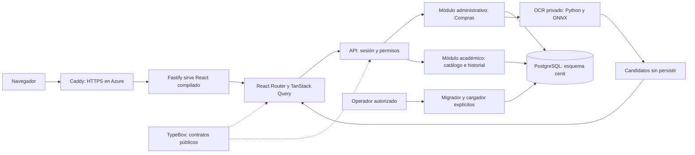

# Diseño de software (SDD): arquitectura y funcionamiento de Cenit

Cenit organiza información administrativa y facilita la consulta académica de Nutrición y Dietética en la Facultad de Medicina de la Universidad Católica del Norte, sede Coquimbo. Este documento explica la solución existente, sus límites y los asuntos que aún requieren definición. La instalación se describe en las [guías de operación](../deploy/LOCAL.md) y las comprobaciones en [Pruebas y criterios de aceptación](PRUEBAS-Y-ACEPTACION.md).

Este archivo es el SDD vigente del repositorio. README es el punto de entrada; `deploy` conserva los procedimientos de operación. No se mantiene otra copia del diseño con decisiones diferentes. Los diagramas siguientes son Mermaid editable en Markdown, revisable junto con el código.

## Estado de la implementación

«Implementado» identifica comportamiento disponible en el código con pruebas enlazadas; «preparado» identifica una herramienta o configuración que requiere ejecución explícita en un destino; «pendiente» identifica definición, validación o comprobación que todavía no se acredita. Ninguno de esos estados sustituye la aceptación del cliente ni confirma qué SHA está instalado actualmente en Azure.

| Área | Implementado | Preparado o pendiente |
| --- | --- | --- |
| Plataforma | Login local, rol por cuenta, sesión de dos horas, frontend compilado servido por API, PostgreSQL persistente | Aceptación de usuarios y comprobación del destino elegido |
| Administrativo | Compras: captura, revisión, alta manual, persistencia, búsqueda, resumen, validación local y eliminación | Precisión OCR acordada con nuevas muestras; actualización de una copia desde otra captura |
| Académico | Consulta por rol, versiones del catálogo, detalle, reglas simples/conjuntas e historiales ficticios | Carga explícita de `diagrama-r2` en cada entorno; año, códigos y aceptación institucional pendientes |
| Personal y Bienes | Navegación y páginas de construcción | Requisitos y módulos funcionales pendientes; no se presentan como entregados |
| Entrega | CI, imágenes por digest, despliegue Azure, migrador separado y recuperación de configuración ante fallos de activación | Catálogo/cuentas se preparan por separado; restauración completa de datos y retiro del servidor anterior requieren ensayo y aprobación |

La [matriz de aceptación](PRUEBAS-Y-ACEPTACION.md) identifica pruebas y evidencia histórica. El estado operativo se obtiene de Actions, `current.json`, health y recorridos autenticados, siguiendo la [guía Azure](../deploy/azure/README.md#diagnóstico-y-recuperación).

## Alcance y entregas

El Project Charter contempla una plataforma modular con Compras, Personal, Bienes y consulta académica. La primera entrega se concentra en Compras y académico. Personal y Bienes forman parte del proyecto completo, pero sus campos, operaciones y reglas deben validarse antes de implementarlos; las páginas actuales sólo informan que esos módulos no están disponibles.

Compras recupera datos de capturas de compras aprobadas previamente en Oracle, permite revisarlos y conserva una copia consultable. Cenit no se conecta a la API de Oracle, no crea ni modifica compras allí y no ejecuta aprobaciones o pagos institucionales. La revisión local, la situación de pago declarada y la aprobación institucional son conceptos diferentes.

El componente académico muestra la malla, las relaciones curriculares recibidas y el avance de estudiantes ficticios. Una relación observada no se transforma en una regla oficial sin cotejo. Se mantienen identificados los prerrequisitos pendientes.

El Charter sitúa el desarrollo entre agosto y diciembre de 2026, con cierre estimado el 11 de diciembre. Esa planificación no acredita que una funcionalidad esté entregada o aceptada. La aceptación requiere pruebas y revisión con los responsables administrativos o académicos. Jira conserva el backlog, las asignaciones y los criterios de cada tarea; este documento resume el funcionamiento y las decisiones técnicas que necesita conocer quien mantiene el sistema.

Quedan fuera del MVP la autenticación institucional y la simulación académica. La iteración de registro incorpora una integración opcional Cenit → Google Sheets, desactivada por defecto; amplía la base del Charter que dejaba Sheets como mejora opcional y requiere coordinación documental de ese alcance. El Charter también excluye simulaciones e integración con la API de Oracle del alcance descrito. No se incorporan procesos de Banner, importación masiva ni nuevos flujos institucionales por inferencia. El uso de datos reales requiere autorización de sus fuentes y acuerdos específicos; los datos ficticios no acreditan esas condiciones.

## Organización del código

Cenit es un monolito modular. El navegador consume un API REST JSON bajo `/api/v1`; PostgreSQL guarda los datos. En producción, Fastify sirve también el frontend compilado, de modo que la web y el API comparten origen. En desarrollo, Vite sirve la web y dirige las llamadas al API local.

| Ubicación | Responsabilidad |
| --- | --- |
| `apps/web/src/app` | Rutas, proveedores, navegación y composición de la interfaz |
| `apps/web/src/features/auth`, `purchases`, `academic` | Pantallas, consultas y presentación de cada funcionalidad |
| `apps/web/src/shared` | Componentes y utilidades que realmente comparten varias funcionalidades |
| `apps/api/src/modules/auth`, `purchases`, `academic` | Rutas, servicios y repositorios de cada módulo |
| `apps/api/src/infrastructure` | Conexión a PostgreSQL, errores, configuración, salud y servicio del frontend |
| `apps/ocr` | Procesamiento auxiliar de imágenes; no guarda compras ni consulta la base |
| `packages/contracts` | Schemas TypeBox/JSON Schema, tipos y formatos públicos del API |
| `db/schema`, `db/migrations` | Modelo Drizzle e historial de cambios de PostgreSQL |
| `db/seeds` | Preparación explícita de datos ficticios y catálogo |
| `catalogs/academic` | Catálogo versionado y referencias a sus fuentes |
| `tests/integration`, `tests/e2e`, `tests/infrastructure`, `tests/ocr` | Pruebas de persistencia/API, navegador, operación y procesamiento |
| `deploy` | Configuración local, Azure y herramientas de la instalación anterior |
| `experiments` | Investigación reproducible separada de la aplicación |

Las rutas adaptan HTTP; los servicios aplican las reglas; los repositorios realizan las consultas. Cada módulo controla su persistencia y evita acceder a estructuras privadas de otro módulo. El frontend comparte contratos públicos con el servidor, no tablas Drizzle ni modelos internos.

### Componentes y límites

El navegador vuelve al mismo origen para consultar `/api/v1`; las flechas representan dependencias, no servicios frontend desplegados por separado. Administrativo accede a Compras; docente y estudiante acceden a académico, con restricciones diferentes para historiales. PostgreSQL se usa con `cenit_app` desde la aplicación y `cenit_migrator` desde herramientas separadas. OCR no recibe credenciales PostgreSQL. La revisión humana y el POST explícito separan extracción de guardado.

En Azure cada entorno tiene su red, contenedores, volumen y secretos independientes, pero comparte la VM y sus recursos físicos. En local Nginx sustituye la entrada Caddy; en desarrollo Vite sirve React y hace proxy al API. Esas variantes y sus puertos están en [Entorno local](../deploy/LOCAL.md#configuración-del-runtime-y-puertos).

Se mantiene React, Vite, TypeScript, React Router, TanStack Query, Tailwind y los componentes seleccionados de shadcn/Radix. El API usa Node.js 24 LTS, Fastify 5, PostgreSQL 17 y Drizzle. Las versiones exactas están en los manifiestos, el único `package-lock.json`, `.node-version` y `deploy/images.lock.json`; no se duplican aquí. REST y las versiones concretas son la base técnica del repositorio, sin atribuirles ratificación institucional. No se añaden microservicios, GraphQL ni abstracciones generales sin una necesidad y decisión documentadas.

Los tests unitarios se colocan junto al código. Los escenarios con PostgreSQL pertenecen a integración; los recorridos de personas, a E2E. Las muestras de OCR y sus valores esperados permanecen separados del extractor. Los datos de PostgreSQL, secretos, capturas de ejecución y compilados no se versionan.

## Autenticación y sesión

El acceso es local, mediante correo y contraseña. Cada cuenta tiene un rol; el login no acepta asignación de rol desde el navegador. No hay registro público, recuperación de contraseña ni autenticación Google implementados.

| Recurso | Acceso |
| --- | --- |
| Compras, extracción, resumen, validación y eliminación | Administrativo |
| Catálogo académico | Docente y estudiante |
| Historial propio `/academic/me/progress` | Estudiante; identidad obtenida de la sesión |
| Búsqueda de estudiantes e historial por identificador | Docente; estudiantes ficticios de Nutrición en la demo |

Los permisos se aplican en el servidor incluso si se consulta el API directamente. Sin sesión se rechaza el acceso; enviar identidad o rol por headers no concede permisos.

Las contraseñas se guardan con scrypt y salt; los tokens de sesión son aleatorios y la base conserva sólo su digest. La cookie `cenit_session` es HttpOnly, SameSite=Lax y Secure por defecto. La sesión dura dos horas fijas desde el login y no se renueva al consultar. Logout revoca la sesión. El rol y la activación de la cuenta se comprueban en el servidor.

Rutas de acceso: `POST /api/v1/auth/login`, `GET /api/v1/auth/session` y `POST /api/v1/auth/logout`. Login y logout requieren un Origin exacto autorizado. El login limita diez intentos por minuto/IP. La excepción de cookie sin Secure se admite sólo con configuración explícita de desarrollo, test o demo HTTP; no es la configuración por defecto de una instalación institucional.

### Iteración de jornada pendiente

Existe un diseño para una iteración posterior con ocho horas absolutas y 60 minutos de inactividad para los tres roles. **No está implementado; sigue vigente la sesión fija de dos horas.** El cambio requiere migración aditiva `absolute_expires_at` nullable, contratos compatibles y conservación del vencimiento original de sesiones anteriores.

El diseño prevé `absoluteExpiresAt` opcional y `expiresAt` efectivo, `POST /api/v1/auth/activity` con cookie y Origin, y extensión únicamente de sesiones válidas hasta su límite absoluto. La actividad humana —escritura, clic, scroll y navegación— se agruparía como máximo una vez por minuto; las consultas automáticas y el movimiento del mouse no extenderían la sesión. BroadcastChannel sincronizaría actividad y salida entre pestañas, con revalidación en servidor y sin transportar borradores o credenciales.

La recuperación futura de un borrador tras vencer sería sólo en memoria de la pestaña, para la misma cuenta y operación. Logout explícito, cancelación, recarga, cierre u otra identidad lo descartarían. Su implementación necesita pruebas con relojes controlados, sesiones anteriores, actividad concurrente con logout, respuestas tardías y compatibilidad de la imagen anterior con la migración. Mientras esté pendiente, sigue vigente el comportamiento actual.

## Compras

Una copia tiene una cabecera y de cero a cien ítems. Número, fecha de envío, descripción general y total son obligatorios; los demás datos pueden ser desconocidos y se representan como `null`. Se conservan identificadores, códigos, ceros, referencias y textos originales. Número de documento e identificador Oracle no son únicos mientras no se confirme su identidad y ámbito institucional.

Los montos se almacenan exactamente en PostgreSQL y se intercambian como cadenas de dígitos no negativas, hasta 255 dígitos por campo. No se usa `Number` para calcular o presentar esos montos. No se exige igualdad entre la suma de ítems y el total documental; tampoco se crean imputaciones presupuestarias no confirmadas. La fecha documental es una fecha civil y no se convierte a UTC. Las fechas internas de creación y revisión sí llevan zona horaria.

| Operación | Ruta y comportamiento |
| --- | --- |
| Guardar | `POST /api/v1/purchases`: cabecera e ítems en una transacción; 201 al crear, 200 al repetir la misma operación |
| Listar | `GET /api/v1/purchases`: estado `all`, `pending` o `reviewed`, filtros, página y total documental de coincidencias |
| Resumen de Inicio | `GET /api/v1/purchases/summary`: `requests`, `pending`, `currency`, `pendingAmount`, `days` y `overview` (agregados, actividad y altas recientes) |
| Capacidades | `GET /api/v1/purchases/capabilities`: `secondReviewEnabled` y `sheetsSyncEnabled`; requiere sesión administrativa |
| Estado de Sheets | `GET /api/v1/purchases/sheets-sync`, opcional `purchaseId`: estado, cantidad pendiente, último éxito y enlace a la planilla |
| Consultar | `GET /api/v1/purchases/:id`: copia completa y procedencia |
| Validar | `POST /api/v1/purchases/:id/validation` con `expectedVersion`: registra la primera revisión local sólo si está habilitada |
| Eliminar | `DELETE /api/v1/purchases/:id` con `expectedVersion`: elimina cabecera e ítems de forma atómica |

La creación usa `operationId` por cuenta: un reintento idéntico devuelve la misma copia; otro contenido con esa operación devuelve 409. La validación concurrente conserva al primer revisor y la versión resultante; repetir una validación ya completada no vuelve a cambiar esos datos. El borrado exige versión vigente, también para copias validadas. Borrar retira la operación de alta: un envío posterior puede crear otra copia, por lo que eliminar/recrear no constituye un mecanismo de corrección desde origen.

Las escrituras requieren sesión administrativa y Origin autorizado. El alta admite hasta 512 KiB de JSON, además de los límites de cada campo y de cien líneas. El límite general de otras solicitudes JSON permanece en 128 KiB. El contrato exacto de cada entrada y respuesta está en [los schemas de compras](../packages/contracts/src/purchases/records.ts).

### Búsqueda y resumen

La búsqueda textual comprende número, descripción y proveedor. Texto, fechas inclusivas y códigos exactos se actualizan tras 250 ms del último conjunto válido, sin botón de aplicar. Una fecha incompleta o un rango inválido conserva el borrador y los últimos resultados e indica qué falta para consultar. Los filtros activos se pueden quitar individualmente; unidad y proyecto deben coincidir en el mismo ítem.

Por defecto hay un listado histórico de veinte registros por página (`reviewStatus=all`) que incluye copias con ambos estados locales. La flag de servidor `CENIT_PURCHASE_SECOND_REVIEW_ENABLED=true` habilita las bandejas «Por revisar en Cenit» y «Revisados en Cenit», con paginación independiente, y la validación posterior. Cambiar o limpiar filtros vuelve las páginas a la primera, también en el listado conjunto. Los filtros aplicados y las páginas se conservan en la URL, y el detalle mantiene el destino de retorno. El total documental suma cada cabecera coincidente una sola vez, incluso si coinciden varios ítems; no representa pagos ni importes imputados. Cada fila incluye el monto documental de su cabecera. En móvil las filas se presentan como tarjetas y la paginación indica página actual y total. Conteo, página y total se leen en un mismo snapshot; las consultas posteriores conservan el contenido mientras se actualiza, reservando los esqueletos para la carga inicial.

Inicio muestra tres indicadores: compras incorporadas en el año, compras incorporadas en el mes y suma exacta de los montos documentales del mes una vez por cabecera. La procedencia desde captura se conserva en los registros, sin un indicador propio porque es el ingreso habitual. Año y mes se calculan por `created_at` en America/Santiago, con ambos estados de revisión, y el período se obtiene del servidor; no dependen de la fecha de envío del documento ni representan pagos. `overview` añade `registeredThisYear`, `documentTotalThisMonth` y `registrationMonth` (`YYYY-MM`); conserva `documentTotal`, `sourceCounts` y los demás agregados históricos. `requests`, `pending`, `pendingAmount` y `days` mantienen sus significados anteriores.

El resumen reúne los últimos treinta días de incorporación, incluidos días sin actividad y lectura textual accesible, y las cinco altas más recientes con acceso al detalle. El gráfico de barras sigue la composición de shadcn con Recharts, cargado al mostrar la actividad: presenta ejes y fecha/cantidad al pasar el cursor, navegar con flechas del teclado o usar el toque. La escala vertical deja margen hasta el siguiente múltiplo de cinco y limita las marcas a una cantidad legible. Su altura ocupa el espacio disponible de la tarjeta, sin reservar un vacío debajo del gráfico. Evita tarjetas que repitan los accesos de la barra lateral y conteos de ejemplos. Personal y Bienes siguen disponibles sólo como páginas en preparación desde la barra; sus indicadores requieren definición. La bienvenida y las superficies son compactas para mostrar todo en escritorio desde 1280×720 con datos habituales; móvil, zoom y valores extensos conservan desplazamiento sin ocultar información. La segunda revisión y Sheets se muestran junto a la actividad sólo cuando están habilitados. Inicio se actualiza al volver después de guardar, validar o eliminar; muestra carga, vacío y error con reintento sin cifras ficticias.

### Interfaz y borradores

El formulario presenta primero los cuatro datos obligatorios y agrupa los complementarios. Los ítems pueden desplegarse; los nuevos o con errores quedan abiertos y la validación lleva el foco al primer campo incorrecto. Las pantallas distinguen carga, vacío y error, tienen etiquetas visibles y no dependen sólo del color.

«Guardar registro» confirma una copia de una compra ya aprobada fuera de Cenit. La condición es una precondición del proceso, no una aprobación certificada por el sistema. El formulario manual se presenta como «Registrar manualmente». Guardar y, cuando esté habilitada, validar sólo muestran éxito tras la respuesta del servidor. Una confirmación contextual permite cancelar descartes, validaciones y eliminación; el fondo permanece bloqueado y el foco vuelve al control correspondiente. La eliminación se ofrece únicamente mediante un ícono con nombre accesible en el detalle.

Los borradores viven en memoria de la pestaña y están ligados a la cuenta. La captura conserva el archivo, sus dimensiones orientadas, candidatos originales, correcciones, identidad de ítems y operationId; las URL de vista previa se recrean y liberan al desmontar. Un fallo temporal de revalidación oculta el contenido y permite recuperarlo sólo tras comprobar la misma identidad, manteniendo el vencimiento original. Logout, 401, expiración, otra cuenta, abandono, cancelación, recarga o cierre los descartan. No se guardan formularios en almacenamiento persistente ni se transportan por URL. Una solicitud de guardado pendiente bloquea salidas voluntarias hasta conocer su resultado.

Fechas visibles `dd/MM/aaaa`, API `YYYY-MM-DD`, calendario en español y validación de fecha civil. La navegación y los diálogos deben funcionar con teclado y pantallas estrechas. El movimiento reducido conserva transiciones discretas; la invalidación de sesión oculta datos inmediatamente. Las medidas de estilo y los detalles de animación se mantienen en componentes y CSS, no como un diario paralelo de ajustes.

### Copia automática en Google Sheets

`CENIT_PURCHASE_SHEETS_SYNC_ENABLED=true` habilita la proyección asíncrona hacia una planilla dedicada, identificada por `CENIT_PURCHASE_SHEETS_ID`. El servidor usa una cuenta de servicio con acceso explícito a ese archivo y una credencial montada mediante `CENIT_PURCHASE_SHEETS_KEY_FILE`. La biblioteca oficial `google-auth-library`, fijada en el lockfile, gestiona autenticación y tokens; el navegador nunca recibe la credencial. Las flags aceptan únicamente `true`/`false` y se leen al arrancar. Una configuración habilitada pero incompleta impide el arranque; no se anuncia una conexión inexistente.

Cenit es el registro principal. Las pestañas «Compras» e «Ítems» conservan cabecera/seguimiento y líneas por separado, enlazadas por ID de Cenit. Incluyen procedencia y metadatos; en cada envío las tres columnas de segunda revisión se ocultan si esa flag está apagada. Los desconocidos se proyectan como celdas vacías. Todos los valores se escriben como texto literal para conservar montos exactos y ceros y evitar fórmulas inferidas. Las pestañas están protegidas para la cuenta de servicio; usar vistas de filtro, copias u otras pestañas para el trabajo derivado. No reordenar filas, cambiar cabeceras ni retirar protecciones de las pestañas administradas: una identidad desplazada o cabecera distinta detiene esa entrega sin sobrescribir otra fila.

Cada alta, primera validación y eliminación deja una generación pendiente en `purchase_sheets_outbox` dentro de la transacción de la compra, incluso con la integración apagada. La migración y el worker incorporan copias anteriores sin cambiar sus datos ni inventar revisores. `purchase_sheets_delivery` conserva filas asignadas y última generación entregada por planilla/registro; no tiene FK de borrado hacia compras. Al eliminar, se vacían las celdas de cabecera e ítems sin desplazar filas de otros registros. Las asignaciones se conservan para que una respuesta perdida o un reinicio reescriban las mismas celdas, sin append duplicado. Estos metadatos son necesarios para completar bajas y reintentos; no conservan el formulario eliminado.

El worker procesa hasta diez registros cada quince segundos y usa un lock PostgreSQL para admitir un solo emisor por base. Un fallo conserva la cola y aplica espera creciente con variación hasta unos minutos. Una nueva generación durante la entrega sigue pendiente. No hay transacción distribuida ni actualización instantánea garantizada: el objetivo normal es menos de un minuto sin fallos ni acumulación. Guardar en Cenit no espera a Google; Inicio/listado/detalle muestran estado y último éxito, y el detalle identifica el estado de su copia. Cambiar de destino conserva entregas independientes y proyecta los registros disponibles al nuevo archivo; no migra el histórico ajeno ni borra automáticamente el destino anterior.

La integración no importa cambios hechos en Sheets, no crea compras en Oracle y no detecta modificaciones posteriores en ese sistema. Las pruebas usan un doble de la API con respuesta perdida y PostgreSQL descartable. La activación real requiere comprobar una planilla de pruebas y sus permisos con datos ficticios antes de cualquier uso institucional. Ver [configuración local](../deploy/LOCAL.md#conectar-una-planilla-de-pruebas).

### Actualización desde origen pendiente

La recuperación de una captura posterior no implementa por sí sola la actualización de una copia. Quedan por definir la identidad de origen, el disparador manual o automático, la revisión de diferencias y los cambios aplicables. No hay edición libre mediante PUT ni un recorrido completo de sincronización. Debe conservarse la copia válida ante fallo y detectarse cualquier conflicto antes de aplicar cambios.

## Capturas y OCR

Desde «Registro de compras → Subir captura», el administrativo arrastra una imagen al recuadro grande o activa ese mismo recuadro por clic o teclado para abrir el explorador. El análisis comienza después de validar el archivo. Imagen y formulario comparten la vista, con zoom, ajuste, recuadros ocultables y una vista compacta ampliable en móvil; el estado de procesamiento no usa porcentajes simulados. En escritorio ambos paneles ocupan la altura disponible: la imagen permanece fija y el formulario se desplaza por separado. Ajustar muestra la imagen completa conservando su proporción; el zoom y el resaltado sólo desplazan su visor. Los avisos y las acciones de cambiar/reintentar tienen espacio propio encima de los paneles. La barra de acciones permite guardar explícitamente desde allí, con los mismos campos, validación e idempotencia del ingreso manual. Reemplazar o volver a extraer pide descartar las correcciones; las respuestas tardías de archivos anteriores se ignoran. El laboratorio de revisión conserva su ruta para QA, sin acceso desde las acciones habituales del listado. Los registros de ese origen siguen identificados como ejemplos en listado y detalle; no se presentan como compras reales.

`POST /api/v1/purchases/extractions` recibe `multipart/form-data` con un único campo `file`. Requiere sesión administrativa y Origin autorizado. Admite PNG/JPEG de hasta 5 MiB y veinte millones de píxeles; no PDF, lotes ni URL remota. Se comprueban contenido, MIME, dimensiones y límites; una extensión o metadata declarada no acreditan un archivo válido. El navegador usa `FormData` y no fija el boundary manualmente.

El procesador auxiliar usa PaddleOCR móvil ONNX mediante RapidOCR. Atiende una extracción a la vez y el API limita el procesamiento a sesenta segundos; sin configuración/procedencia válida o sin capacidad responde 503. Los modelos se verifican por hash y no se descargan durante una solicitud. La imagen se procesa temporalmente, no se conserva como anexo ni se registra en logs. [Modelos, hashes y licencias](../apps/ocr/MODELS.md).

La salida distingue recuperado, ausente, inválido y ambiguo; los valores desconocidos quedan en `null`. Las incidencias conservan la referencia al campo y el original no se modifica durante la revisión. `captureLayout` informa señales del formato; ni ese reconocimiento ni el color acreditan autenticidad. Las capturas parciales pueden aportar candidatos, mientras que un logo, fondo azul o título aislados no bastan para aceptar el formato. Las regiones opcionales de regions enlazan rutas de campos con x/y/width/height normalizados respecto de la imagen orientada mediante EXIF. Sólo se incluyen tokens o celdas efectivamente usados; se rechazan rutas inexistentes, candidatos ausentes y regiones fuera de la imagen. Enfocar un campo destaca su región; seleccionar un recuadro abre su sección y lleva al campo. Sin evidencia se indica «Sin ubicación disponible». Las correcciones se distinguen de los originales y los opcionales vacíos no se marcan como errores obligatorios. Los [contratos de extracción](../packages/contracts/src/purchases/extraction.ts) definen los estados y errores públicos.

La procedencia puede ser manual, `contract_example` o `image_capture`. Para una captura, el servidor firma identificador de extracción, versión de procesador y fecha, ligados a la cuenta. El recibo es válido dos horas para una nueva alta; el reintento de una operación ya conservada mantiene su idempotencia. Se almacena esa referencia de procesamiento, no la imagen. La firma no certifica que los datos corregidos sean verdaderos institucionalmente.

La versión de procesamiento actual es `ppocr5-latin-grid8-layout-v4` (regiones opcionales; una respuesta del adaptador anterior sin regiones conserva la identificación v3). La exactitud debe evaluarse por campo y muestra; la evaluación sintética de desarrollo no sustituye una muestra representativa y criterios acordados con el cliente. Los comandos de investigación y resultados congelados se conservan en [los experimentos de compras](../experiments/purchases/README.md); el [registro de pruebas](PRUEBAS-Y-ACEPTACION.md) distingue inferencia real de respuestas controladas.

## Académico

El catálogo de trabajo es [diagrama-r2](../catalogs/academic/nutricion-diagrama-r2.json): 52 asignaturas, 305 SCT y cuatro internados agrupados en IX–X. La [imagen recibida](Foto%20prerequisitos%20Nutricion.jpeg) es la fuente curricular vigente; el año oficial del plan no está confirmado. El PDF antiguo fue retirado y su referencia se conserva únicamente como antecedente histórico de `2027-r1` y del [cotejo](COTEJO-CATALOGO-ACADEMICO.md).

Los códigos `NUT2027-001` a `NUT2027-052` son identificadores internos heredados: el prefijo no acredita el año del plan y `officialCode` permanece `null`. Imagen y cotejo tienen hashes, fecha y estado `teamReviewed`; esta revisión del equipo no equivale a `clientValidated` ni se atribuye a Registro Curricular.

La interpretación aclarada por el líder produce 43 relaciones, 26 reglas simples, ocho `allOf` y 18 `pending`. Una flecha apunta a la asignatura que exige el requisito; varias entradas exigen todos los cursos. APS exige Dietética y Modelo de intervención; el integrador exige Proyecto de innovación, Gestión estratégica de sistemas y Nutrición clínica materno infanto juvenil. Internado APS exige sólo Proyecto de intervención comunitaria, por aclaración explícita, sin generalizar el corchete a otros internados. El cotejo identifica esa aclaración como fuente de la relación. La ausencia de flechas no confirma ausencia de requisitos: `none` exige confirmación expresa. No hay evaluación de habilitación ni simulación.

`2027-r1`, sus migraciones y registros publicados permanecen intactos y consultables donde estén instalados. La carga transaccional explícita prepara la nueva versión sin trasladar adscripciones ni historiales. El selector existente permite consultarla sin aplicar el historial de otra versión; no cambia la selección inicial del frontend. La preparación de demo rechaza un cambio de versión de un historial existente. La aceptación institucional de la historia y las dependencias de validación de fuentes siguen pendientes.

La propuesta de presentación de SCRUM-72 reutiliza el detalle de la malla: requisito simple por nombre, «Todos los siguientes» y «Al menos uno de los siguientes» con listas, ausencia confirmada sólo ante `none`, y estados «Pendientes de confirmación» y «Regla no soportada» con su explicación recibida. Las relaciones observadas se muestran aparte y no sustituyen esas condiciones. El diálogo permite teclado y retorno de foco. Los ejemplos de revisión son ficticios y no se publican ni se usan como reemplazo ante fallos del API. El diseño espera aprobación; la entrega de SCRUM-74 prepara la publicación versionada con revisión del equipo. La aceptación de SCRUM-75 y la validación institucional de la fuente de SCRUM-71 siguen pendientes. La [matriz de aceptación](PRUEBAS-Y-ACEPTACION.md#consulta-académica) contiene el recorrido reproducible y sus límites.

La malla permite explorar conexiones directas e indirectas mediante mouse, teclado y toque, con contornos diferenciados y explicación del curso intermedio. El detalle conserva requisitos separados de relaciones visuales. Las conexiones se recorren localmente a partir de `prerequisiteEdges`; no calculan habilitación ni infieren reglas nuevas. El mockup de revisión usa datos ficticios separados del catálogo publicado.

En pantallas estrechas los semestres se apilan; en escritorio se conservan controles, arrastre y desplazamiento horizontal del tablero. Escape limpia la exploración o cierra el diálogo según el contexto; el foco vuelve al control de origen. Colores, transiciones y movimiento reducido pertenecen a componentes/CSS y se verifican en los recorridos de navegador de la matriz.

| Consulta | Ruta |
| --- | --- |
| Planes disponibles | `GET /api/v1/academic/plans` |
| Versión y asignaturas | `GET /api/v1/academic/plans/:planId/versions/:version` |
| Historial propio | `GET /api/v1/academic/me/progress` |
| Búsqueda docente | `GET /api/v1/academic/students` |
| Historial seleccionado | `GET /api/v1/academic/students/:studentId/progress` |

Las consultas validan la respuesta pública y distinguen vacío, error y falta de acceso. El historial sólo se muestra sobre el mismo plan/versión. El frontend no reemplaza errores con un catálogo fijo ni infiere «no cursada» de un historial inválido.

El docente combina nombre y prefijo de RUT con AND; la búsqueda espera 250 ms y la interfaz muestra seis resultados por página. El RUT conserva su texto, admite búsqueda con/sin puntos y verifica módulo 11 cuando está completo; no acredita identidad ni matrícula. La API admite paginación validada y escapa comodines de la búsqueda.

Los historiales de demostración distinguen aprobada, reprobada, en curso y no cursada. Muestran intentos numerados, estado del último intento y última nota aprobatoria. Las notas JSON son texto con coma y un decimal significativo, omitiendo el decimal cero: `4,1`, `6`, `6,5`; SCT sigue siendo numérico. La escala 1–7 y aprobación desde 4 corresponden a los datos ficticios acordados, sin inferir una política universal de notas. No hay edición pública de historiales, porcentajes ni persistencia de simulaciones.

## Persistencia y contratos

Los objetos de negocio viven en el esquema PostgreSQL `cenit`. Cuentas, sesiones, compras, catálogo, perfiles, adscripciones e intentos tienen FKs y restricciones propias. Los repositorios usan consultas parametrizadas y transacciones; los montos no pierden precisión ni se duplican por joins.

Las respuestas del API y sus entradas se definen en `packages/contracts`. Los errores usan `{error:{code,message,requestId}}` y `X-Request-Id`, sin SQL ni trazas internas. Las respuestas protegidas llevan `Cache-Control: no-store`. Los consumidores validan el JSON; los tipos de TypeScript no reemplazan esa validación ni los permisos del servidor.

El runtime usa una credencial limitada; el migrador, otra separada. El esquema se aprovisiona antes de migrar. Para actualizar se usa exclusivamente `deploy/migrate.cjs`, con transacción, lock e historial verificado por timestamp/hash. No se editan ni renombran SQL ya aplicados.

El journal conjunto conserva las migraciones de compras y añade el SQL académico original `0003_academic_progress` como entrada 7; `meta/_legacy.json` reconoce su timestamp/hash anterior. No se exige que un historial previo sea un prefijo del journal combinado; entradas desconocidas, alteradas o duplicadas se rechazan. Las migraciones posteriores mantienen esa compatibilidad. Las migraciones y CD no crean cuentas, catálogo ni datos de demo.

El catálogo publicado es inmutable; su carga valida códigos, fuentes, referencias, profundidad y ciclos antes de publicar en una transacción. El historial académico mantiene FK a `cenit.accounts.id`, sin duplicar identidades para desbloquear un recorrido.

## Entornos y mantenimiento

[Desarrollo y demostración local](../deploy/LOCAL.md) explican configuración, preparación ficticia y arranque. `npm run dev` comprueba/verifica las tres cuentas de demo con los secretos locales antes de iniciar API/Vite; no migra ni carga catálogo o historiales. Esta preparación existente es exclusiva del arranque local. Las demás preparaciones son comandos explícitos y no se ejecutan desde CD.

[Azure](../deploy/azure/README.md) es el destino de entrega: `develop` despliega staging y `main` producción de la demostración, después de CI. El servidor anterior permanece como [referencia de transición](../deploy/README.md); no se retiran sus datos o servicios sin transferencia y recorridos verificados.

Readiness comprueba conexión, historial de migraciones, esquema y permisos del runtime; no exige datos sembrados ni finge disponibilidad. Los backups anteriores a una entrega y la recuperación de una imagen no acreditan una restauración completa de datos. La operación no debe borrar volúmenes, hacer prune global o restaurar datos automáticamente como rollback de una aplicación.

## Documentación y aceptación

Esta guía describe el funcionamiento que necesita comprender quien desarrolla o mantiene Cenit. Los comandos operativos tienen su guía propia y los criterios se relacionan con pruebas en la matriz. El Project Charter conserva la definición del proyecto; Jira y las actas registran compromisos y aceptación. La existencia de código o una prueba correcta no se presenta como validación del cliente.

El equipo confirmó Markdown del repositorio como formato de entrega documental. El SDD, README, guías y diagramas se revisan en el mismo cambio que el código correspondiente; cualquier exportación adicional requiere confirmar previamente su necesidad y formato. El procedimiento de carga de catálogo y el de recuperación pertenecen a la guía Azure, no se duplican en este documento.

Cuando cambia un comportamiento se actualiza su sección, manteniendo en Git el historial anterior. Las decisiones arquitectónicas relevantes conservan su motivo: monolito modular para el alcance actual, contratos compartidos para evitar diferencias entre consumidores, montos exactos para preservar datos documentales, OCR auxiliar para separar inferencia y persistencia, y reglas pendientes para no inventar condiciones académicas. Las notas de sesión y las listas de ajustes ya implementados pertenecen a la revisión del cambio, no a nuevos documentos permanentes.
