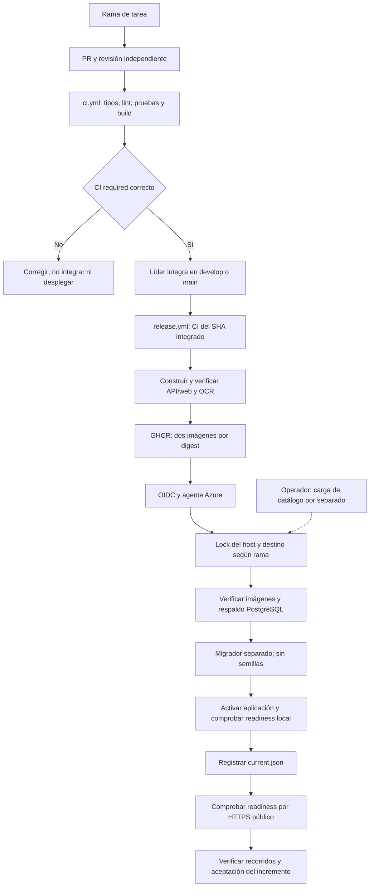

# Operar Cenit en Azure

La demostración se entrega en Azure **Chile Central** mediante GitHub Actions, con aplicación, PostgreSQL y OCR. El presupuesto disponible es **USD 200 en total hasta diciembre de 2026**. Azure sustituye el destino y el polling de la VM anterior; conserva los contratos de la aplicación, el migrador separado y la revisión por PR.

| Rama protegida | Entorno | Dirección |
| --- | --- | --- |
| `main` | Producción de la demostración | `https://cenit.dpdns.org` |
| `develop` | Staging | `https://develop.cenit.dpdns.org` |

Una sola B2als v2, Linux/amd64, 2 vCPU y 4 GiB; SSD estándar de 64 GiB e IPv4 fija. Ambos entornos tienen contenedores, redes, volúmenes PostgreSQL, contraseñas y claves de procedencia independientes. Cada uno incluye su propia versión OCR. Se usa Docker Compose en esta VM dedicada para reutilizar el inicializador y los secretos del Compose ya ensayado; la instalación Podman de la VM compartida y el entorno local se conservan durante la transición. Caddy del host termina HTTPS y renueva certificados. Sólo 80/443 tienen entrada pública; API, PostgreSQL y OCR no publican puertos externos. Administración mediante el agente Azure.

## Costos consultados

Referencia histórica de la API oficial [Azure Retail Prices](https://learn.microsoft.com/en-us/rest/api/cost-management/retail-prices/azure-retail-prices), USD, Chile Central, consultada el 17 de octubre de 2026. Revisar precios y saldo antes de ampliar recursos:

| Recurso | Precio consultado | Estimación para 730 h |
| --- | --- | --- |
| B2als v2 Linux | USD 0,0526/h | USD 38,40 |
| SSD E6 LRS, 64 GiB | USD 6,72/mes | USD 6,72 |
| IPv4 pública estándar | USD 0,005/h | USD 3,65 |

Base aproximada: **USD 49/mes**, o **USD 120–130 del 17 de octubre al 31 de diciembre**. Agregar operaciones del disco, tráfico e impuestos aplicables. No hay PostgreSQL administrado, ACR, balanceador ni segunda VM. Un presupuesto de Azure sirve para avisar; **no detiene el consumo**. La fecha `expires` de las etiquetas tampoco apaga recursos. La duración real y el saldo del crédito se verifican en la cuenta, no se deducen del importe inicial.

Los límites suman 3,25 GiB para los seis contenedores; los procesos normalmente consumen menos. Hay consumo adicional del host y del migrador temporal. Medir ambas extracciones simultáneas y durante una entrega antes de acreditar capacidad. Staging comparte CPU/disco con producción. No se promete alta disponibilidad ni ausencia de interrupciones.

## Infraestructura reproducible

`main.bicep` contiene red, NSG, IPv4, VM, identidad y federación. `cloud-init.yaml` prepara Docker Compose y Caddy desde paquetes Ubuntu. El script no instala runners de PR en la VM ni hace builds allí.

Con Azure CLI autenticado en la cuenta y suscripción del proyecto, comprobar el destino antes de aprovisionar:

```bash
az account show --query '{id:id,user:user.name}'
az group create --name cenit-azure --location chilecentral
az deployment group validate --resource-group cenit-azure \
  --template-file deploy/azure/main.bicep --parameters @.local/azure/parameters.json
az deployment group create --name cenit-initial --resource-group cenit-azure \
  --template-file deploy/azure/main.bicep --parameters @.local/azure/parameters.json
```

El archivo privado de parámetros contiene una clave SSH pública y una versión exacta de Ubuntu; la clave privada permanece en `.local/azure`, ignorada por Git. No habilitar SSH público para las entregas. `config.json` conserva sólo IDs públicos y nombres de recursos obtenidos del output Bicep, sin tokens ni contraseñas.

## GitHub Actions

Tras revisión e integración por PR, un push a `develop`/`main` ejecuta CI completo del SHA integrado, construye/verifica la aplicación, descarga los dos pesos OCR con sus SHA-256 ya existentes, verifica inferencia real sin red y publica ambas imágenes por digest en GHCR. Un fallo impide desplegar.

Azure Login usa OIDC con sujetos exactos `repo:Menderin@167567835/Cenit@1340887682:ref:refs/heads/main` y `repo:Menderin@167567835/Cenit@1340887682:ref:refs/heads/develop`. Este repositorio usa el [formato inmutable de GitHub](https://docs.github.com/en/actions/reference/security/oidc#immutable-subject-claims), con IDs de propietario/repositorio verificados mediante la API y el token de la ejecución; el formato anterior basado sólo en nombres provoca `AADSTS700213`. Los IDs públicos no requieren secretos Azure en GitHub. La identidad tiene Virtual Machine Contributor **sólo sobre esta VM**, no sobre la suscripción. Ese permiso permite ejecutar como root en el host compartido por ambos entornos: se confía en las dos ramas protegidas. No añadir federación para ramas de tarea ni PRs.

`run-command.py` vuelve a exigir repositorio/evento/rama y digests esperados. Envía el token efímero de GHCR como parámetro protegido del agente, nunca como parte del script. El host usa un directorio temporal de autenticación y lo elimina al terminar. No se guardan PAT ni claves Azure permanentes para las entregas.

Las entregas se serializan en el host. Cada entorno rechaza runs anteriores al instalado, verifica las etiquetas OCI de ambas imágenes, conserva las credenciales existentes y crea/verifica `pg_dump` antes del migrador separado. No se ejecutan semillas, cargas de catálogo, cuentas ni resets. Una migración fallida/interrumpida deja `migration-blocked`: revisar el ledger y la base antes de retirar ese marcador explícitamente. Una aplicación fallida intenta recuperar imágenes/configuración anteriores; nunca restaura datos automáticamente. Las imágenes deben conservar compatibilidad con la base tras migrar.

Estado, Compose, credenciales y backups viven en `/opt/cenit/production` o `/opt/cenit/staging`, con acceso privado de root. Los backups locales no protegen frente a pérdida del disco/VM; exportar un respaldo verificado fuera del host antes del retiro definitivo del servidor anterior. No ejecutar `down --volumes`, prune global ni borrar volúmenes para resolver fallos.

El workflow comprueba readiness por HTTPS al terminar. Sin DNS/certificado válido la entrega no se declara exitosa. Primera preparación de cuentas/catálogo o transferencia de datos: operación privada explícita separada, conservando identidades y credenciales; nunca incluirla en CD.

### Flujo de una entrega y controles



`ci.yml` se ejecuta para PR hacia `develop`/`main`, pushes de las ramas configuradas y llamadas reutilizables. `CI required` reúne los resultados aplicables de Prerequisites, Infrastructure y Application; Academic foundation es una variante histórica condicionada por el verificador. Un job omitido sólo es válido si el gate lo permite; no equivale a una prueba ejecutada. La aplicación completa se comprueba con tipos, lint, unitarias, integración PostgreSQL, build, navegador compilado y verificación de imagen. La publicación añade el ensayo OCR real sin red con muestras ficticias.

`release.yml` sólo despliega tras un push a una rama permanente: abrir o aprobar el PR no despliega. `develop` selecciona staging y `main` producción demo. El workflow actual no usa `CENIT_RELEASE_ENABLED`, GitHub Releases ni el timer del servidor anterior. Un éxito de CI en la rama de tarea no acredita la entrega del SHA integrado.

El token de GHCR es temporal y protegido; Azure recibe identidad federada, no una contraseña guardada en el YAML. Los digests y el SHA permiten comprobar qué se probó/instaló. No se usa `latest`, no se hace `git pull` ni se compila en la VM. Una carga de catálogo o cuentas requiere su propia operación, aunque la aplicación ya esté saludable.

### Configuración por entorno

No copiar `.env` local a Azure. `deploy.sh` genera en cada directorio privado las variables de Compose y conserva los secretos existentes. Los valores públicos están en `config.json` y en el mapeo de `run-command.py`; las versiones de imágenes base, en `deploy/images.lock.json`.

| Configuración | Staging | Producción demo |
| --- | --- | --- |
| `CENIT_ENV` | `staging` | `production` |
| `CENIT_ORIGIN` / `AUTH_ALLOWED_ORIGINS` | `https://develop.cenit.dpdns.org` | `https://cenit.dpdns.org` |
| `CENIT_HTTP_PORT` en loopback | `8082` | `8081` |
| Directorio privado | `/opt/cenit/staging` | `/opt/cenit/production` |
| `CENIT_APP_IMAGE`, `CENIT_OCR_IMAGE` | Digests verificados de la entrega de `develop` | Digests verificados de la entrega de `main` |
| Runtime | `NODE_ENV=production`, `APP_ENV=demo`, `AUTH_COOKIE_SECURE=true`, puerto interno `3000` | Misma configuración de runtime; la base y los secretos son independientes |
| Copia de compras a Sheets | Activada por `compose.sheets.yaml` tras integrar y desplegar `develop` | Desactivada; el overlay de Sheets ni siquiera se incluye en el paquete `main` |

`APP_ENV=demo` identifica el producto de demostración; no obliga a usar HTTP ni contradice el nombre del entorno de producción. La configuración completa del runtime está en [Entorno local](../LOCAL.md#configuración-del-runtime-y-puertos), con sus diferencias por destino.

| Referencia privada relativa al directorio del entorno | Consumidor |
| --- | --- |
| `.local/secrets/postgres-password`, `app-password`, `migrator-password` | Inicialización PostgreSQL; no se rotan por cambiar el archivo |
| `.local/secrets/app-url` → `/run/secrets/app-url` | API con `cenit_app` |
| `.local/secrets/migrator-url` → `/run/secrets/migrator-url` | Migrador y cargador de catálogo con `cenit_migrator` |
| `.local/secrets/capture-receipt-key` | API para firmar procedencia; OCR no recibe este secreto ni acceso a la BD |
| Staging: `.local/secrets/purchase-sheets-id` y `purchase-sheets-key.json` | ID de la planilla dedicada y clave JSON de cuenta de servicio; el overlay entrega la clave sólo a la API |

Para habilitar Sheets en staging, aprovisionar ambos archivos directamente en `/opt/cenit/staging/.local/secrets/` por el canal privado de operaciones, antes de integrar la activación. `purchase-sheets-id` contiene sólo el ID (no la URL) de la hoja ficticia dedicada. La cuenta de servicio debe tener permiso de edición únicamente sobre esa hoja. El deploy valida ambos archivos sin imprimir sus contenidos; mantiene el directorio privado, limita el ID y expone la clave JSON legible por el usuario de la API sólo dentro de ese directorio protegido. Si falta o no es válida, el despliegue se detiene antes de migrar o activar. No poner credenciales ni ID en variables versionadas, YAML, logs, Actions o artefactos. La activación sólo prepara el conector: verificar después del despliegue que la cola y la hoja responden correctamente antes de declarar la prueba real terminada.

Los archivos privados no se incluyen en Git, imágenes ni artefactos públicos. El runtime no recibe las claves ficticias de login para arrancar. Antes de usar una cuenta en un entorno nuevo, su preparación/transferencia debe comprobarse de forma explícita; el deploy no acredita que exista.

## Publicar el catálogo académico (operación explícita)

Responsable: quien opera el despliegue Azure, con revisión del catálogo por el equipo académico/backend. La entrega instala el cargador compilado, `diagrama-r2` y sólo sus fuentes de imagen/cotejo en la misma imagen de aplicación. No necesita `tsx`, dependencias de desarrollo, clonar el repositorio ni compilar en la VM. El servicio `catalog` usa un perfil explícito y la credencial de `cenit_migrator`; no se ejecuta al arrancar la aplicación ni durante CD.

Primero integrar estos cambios y esperar la entrega correcta de `develop` para staging. Producción requiere su propia entrega revisada a `main` y una carga separada: las bases son independientes. Una imagen anterior no contiene este cargador; no improvisar INSERTs ni cambiar la credencial de la aplicación para resolverlo.

En Azure Portal, abrir la VM confirmada en `config.json`, **Run command → RunShellScript** (ejecuta como root). También puede usarse el agente Azure con la CLI autenticada del operador; no habilitar SSH público. Ejecutar el siguiente bloque completo, comenzando con `staging`. Para producción cambiar únicamente `CENIT_TARGET=production`, después de revisar y autorizar ese destino.

El bloque se serializa con las entregas, verifica la imagen instalada, comprueba el catálogo sin escribir, crea/verifica un respaldo y luego publica en una transacción. Si falta la herramienta o falla la verificación, se detiene antes de cargar. No imprime credenciales.

```bash
bash <<'CENIT_CATALOG'
set -Eeuo pipefail
umask 077
CENIT_TARGET=staging
[[ $EUID == 0 && $CENIT_TARGET =~ ^(staging|production)$ ]]
exec 9>/run/lock/cenit-azure.lock
flock -w 600 9
cd "/opt/cenit/$CENIT_TARGET"
[[ -f current.json && -f .env && -f compose.yaml && ! -f migration-blocked ]]
dc() { docker compose --env-file .env -f compose.yaml "$@"; }

# El proyecto y la imagen efectivos deben coincidir con la entrega instalada.
dc --profile catalog config --format json > /run/cenit-catalog-config.json
python3 - "$CENIT_TARGET" <<'PY'
import json, sys
from pathlib import Path
config = json.loads(Path('/run/cenit-catalog-config.json').read_text())
current = json.loads(Path('current.json').read_text())
assert config['name'] == 'cenit-' + sys.argv[1], 'Proyecto incorrecto'
assert config['services']['catalog']['image'] == current['image'], 'Imagen incorrecta'
print('Destino:', sys.argv[1], 'Commit:', current['commit'], 'Imagen:', current['image'])
PY
rm /run/cenit-catalog-config.json
dc config --quiet
dc run --rm --no-deps --pull never catalog --check

install -d -m 700 backups
backup="backups/catalog-$(date -u +%Y%m%dT%H%M%SZ).dump"
dc exec -T db pg_dump -U cenit_admin -d cenit_demo -Fc > "$backup.partial"
dc exec -T db pg_restore --list < "$backup.partial" >/dev/null
mv "$backup.partial" "$backup"
printf 'Respaldo verificado: %s\n' "$backup"

dc run --rm --no-deps --pull never catalog --publish
dc exec -T db psql -U cenit_admin -d cenit_demo -v ON_ERROR_STOP=1 -c "
SELECT v.version, v.status,
 (SELECT count(*) FROM cenit.academic_courses c WHERE c.version_id=v.id) AS asignaturas,
 (SELECT count(*) FROM cenit.academic_prerequisite_edges e WHERE e.version_id=v.id) AS relaciones,
 (SELECT sum(credits) FROM cenit.academic_courses c WHERE c.version_id=v.id) AS sct
FROM cenit.academic_versions v
WHERE v.plan_id='nutricion-dietetica' AND v.version='diagrama-r2';"
CENIT_CATALOG
```

Resultado esperado: `diagrama-r2`, `published`, **52 asignaturas, 43 relaciones y 305 SCT**. Repetir la carga del mismo contenido devuelve `unchanged`, sin duplicar. Una versión existente con contenido diferente se rechaza; no editar SQL, borrar versiones ni forzar sobrescrituras. Ante fallo, conservar el respaldo y revisar el estado; no restaurarlo automáticamente. El `--check` verifica estructura y hashes, no certifica aceptación institucional.

Comprobación funcional: iniciar sesión como docente o estudiante en el entorno elegido y abrir `/academico`; pulsar «Volver a consultar» o recargar. Si ya estaba publicada `2027-r1`, seleccionar `diagrama-r2` en «Versión del plan»: la selección inicial no cambia automáticamente. Revisar Inocuidad, APS y Módulo integrador. La API autenticada `GET /api/v1/academic/plans` debe incluir la versión y `GET /api/v1/academic/plans/nutricion-dietetica/versions/diagrama-r2` debe devolver su contenido. Un administrativo no tiene acceso a estas consultas.

La operación no crea usuarios, historiales ni adscripciones y no mueve los existentes. Si un estudiante tiene historial de otra versión aparecerá el aviso correspondiente; si no tiene historial, no se inventa uno para mostrar avance. El año oficial y la aceptación institucional de las reglas siguen pendientes. Para una versión futura, preparar y revisar sus archivos/fuentes en otra entrega; este procedimiento publica únicamente el catálogo empaquetado y verificado.

## Diagnóstico y recuperación

Responsable: operador del destino, con revisión backend/BD si hay migraciones o datos afectados. Usar Azure Run Command sobre la VM confirmada; conservar privados los logs y correlacionar errores de API mediante `X-Request-Id`, sin copiar formularios, cookies o credenciales a tickets. No compartir `.env` ni las URLs de conexión.

### Inspección sin modificar datos

Ejecutar este bloque completo desde RunShellScript en la VM confirmada. Elegir el entorno explícitamente; los comandos no detienen ni recrean servicios:

```bash
bash <<'DIAGNOSTICO'
set -eu
CENIT_TARGET=staging
case "$CENIT_TARGET" in staging) CENIT_CHECK_PORT=8082;; production) CENIT_CHECK_PORT=8081;; *) exit 1;; esac
cd "/opt/cenit/$CENIT_TARGET"
dc() { docker compose --env-file .env -f compose.yaml "$@"; }
python3 - <<'PY'
import json
from pathlib import Path
current = json.loads(Path('current.json').read_text())
print({key: current[key] for key in ('commit', 'runNumber', 'image', 'ocrImage')})
print('migration-blocked:', Path('migration-blocked').exists())
PY
dc ps -a
df -h /opt/cenit
docker stats --no-stream
systemctl --no-pager status docker caddy || true
curl --max-time 5 -i "http://127.0.0.1:$CENIT_CHECK_PORT/health/live"
curl --max-time 5 -i "http://127.0.0.1:$CENIT_CHECK_PORT/health/ready"
DIAGNOSTICO
```

Si es la primera entrega y aún no existe `current.json`, revisar la ejecución fallida en Azure; no crear ese archivo manualmente. Para logs privados: `dc logs --tail 80 app db ocr` y `journalctl -u caddy -n 80 --no-pager`. Para comprobar OCR desde su propia red/proceso: `dc exec -T ocr python -c "import urllib.request; print(urllib.request.urlopen('http://127.0.0.1:8090/health/live', timeout=3).read().decode())"`. Los [health y sus límites](../LOCAL.md#comprobar-salud-sin-confundirla-con-aceptación) explican por qué readiness correcto no acredita OCR ni un catálogo cargado.

| Síntoma | Diagnóstico y siguiente paso |
| --- | --- |
| CI o construcción fallidos | No se publica una nueva entrega. Corregir la rama y repetir CI; no instalar manualmente una imagen para eludirlo |
| `AADSTS700213`, descarga GHCR o agente fallidos | Comprobar rama/sujeto OIDC, permisos acotados, digests y ejecución Azure. El estado de ARM por sí solo no acredita que el script haya terminado |
| Readiness local 503 | Revisar PostgreSQL, ledger, permisos y columnas requeridas. No ejecutar semillas, modificar hashes ni recrear la base |
| Readiness local 200 y HTTPS público falla | Revisar DNS, certificado, Caddy y loopback del entorno. El último paso HTTPS del workflow ocurre después de `current.json`; su fallo no dispara el rollback interno del script |
| Login 401 / escritura 403 | Sesión ausente o credencial rechazada / rol u Origin no autorizado. Comprobar cuentas preparadas, origen exacto y cookie Secure sobre HTTPS. No confundir 504 con contraseña incorrecta |
| 502/504, reinicios o lentitud | Revisar estado, logs, memoria, disco y procesos de ambos entornos antes de reiniciar. No aumentar recursos ni detener servicios ajenos sin decisión del operador |
| Extracción 503 con compras disponibles | Revisar salud/capacidad de OCR, `OCR_URL`, clave y tiempo máximo. Reintentar de forma controlada; no reemplazar la respuesta por un ejemplo |
| Malla vacía | Confirmar versión publicada mediante el API y ejecutar la carga explícita si falta. No migrar historiales ni crear alumnos para simular disponibilidad |

### Recuperación de aplicación y migraciones

1. Revisar Actions y el Run Command fallido, el SHA/digests, `current.json` y el estado de los contenedores. La entrega mantiene el lock `/run/lock/cenit-azure.lock`; no interrumpir ni competir con una migración en curso.
2. Si falló la activación dentro de `deploy.sh`, revisar si su rutina recuperó `previous.env`/`previous.compose.yaml` y la aplicación anterior. Si no había configuración anterior, intenta detener los servicios nuevos. Es un intento de recuperación, no una garantía de disponibilidad ni una restauración de datos.
3. Si existe `migration-blocked`, conservarlo. El responsable de BD debe contrastar ledger, hashes y resultado de la transacción con las migraciones empaquetadas. Sólo tras confirmar un estado coherente se retira explícitamente el marcador y se reintenta una entrega revisada. No editar SQL aplicado, journal o aliases para forzarla.
4. Para volver a comportamiento anterior, preferir un cambio de reversión/corrección revisado que genere una nueva ejecución de Actions, con número posterior. Debe funcionar sobre la BD ya migrada: revertir código no revierte el esquema. Reejecutar un run antiguo puede ser rechazado por la protección de orden; no alterar `current.json` para evitarla.
5. Tras recuperar, comprobar readiness local y HTTPS, login de los tres roles, compras conservadas, catálogo y OCR ficticio. Registrar el resultado en la revisión/incidencia con SHA/digests; no declararlo correcto sólo porque un contenedor está `running`.

### Respaldo y pérdida de datos

La entrega y la carga de catálogo crean dumps privados y comprueban su índice con `pg_restore --list`. Eso acredita un archivo legible, no un ensayo completo de restauración ni protección frente a perder la VM. Exportar un respaldo verificado fuera del host mediante el canal privado acordado; no incluirlo en el repositorio o en artefactos públicos.

Una restauración de datos requiere acordar destino, punto de recuperación y tratamiento de escrituras posteriores. Debe ensayarse primero en PostgreSQL separado, revisar integridad/roles y recorridos, y autorizar cualquier intervención sobre la base de aplicación. No hay restaurador automático ni un ensayo completo en Azure acreditado aquí; tampoco un objetivo de recuperación temporal acordado. Mantener ese trabajo como pendiente del operador, sin inventar un RTO/RPO ni ofrecer un comando que sobrescriba producción.

## DNS y transición

En el editor DNS que administra la zona de DigitalPlat, crear dos registros **A** hacia la IPv4 fija confirmada por Azure: nombre `@` y nombre `develop`, TTL 300–3600. Conservar los NS existentes. No asumir que cambiar NS crea esos registros. Antes de modificar otros A/AAAA/CNAME, revisar cuáles existen; un AAAA anterior puede enviar clientes a otro servidor. Para HTTPS directo, ambos nombres deben resolver a la VM y permitir 80/443.

Las ramas de tarea no despliegan. El líder crea los PR y promueve `develop` a `main`, con revisión independiente y CI.

Antes de retirar la instalación anterior: obtener un respaldo, transferir/verificar cuentas y datos necesarios, comprobar login de los tres roles, búsqueda/guardado/revisión de compras, malla, OCR real, HTTPS y persistencia tras recrear contenedores/reiniciar. Ensayar recuperación de aplicación fallida. Registrar commit/digests, tiempos y memoria de OCR en Chile.

Sólo después, detener los timers y servicios **de Cenit** en la VM compartida. Conservar respaldo y posibilidad de recuperación; no tocar Zableke, Jenkins, Tailscale del host ni borrar la base. La [guía de la instalación anterior](../README.md) reúne sus procedimientos de transición; su polling de releases no corresponde al workflow Azure.

## Instalación y comprobaciones

La instalación registrada usa el grupo `cenit-azure`, VM `cenit` B2als v2 en Chile Central, IPv4 fija **57.156.63.4**, SSD de 64 GiB e identidad/OIDC para `main` y `develop`. Consultar `config.json` y Azure antes de intervenir: un valor documentado no sustituye comprobar el recurso vigente.

Presupuesto Azure `cenit-until-december`: USD 180 trimestrales para octubre-diciembre, avisos al correo de la cuenta en 50/80/100 % (USD 90/144/180). No es un corte automático. Los IDs públicos están en `config.json`.

La integración del PR #22 en `develop`, commit `82452bd2fc45101b00eeeeadde833148511d8897`, tiene [CI correcto](https://github.com/Menderin/Cenit/actions/runs/39157939078) y [entrega correcta](https://github.com/Menderin/Cenit/actions/runs/39157939205) del 18 de octubre de 2026, incluida inferencia OCR sin red, despliegue y readiness HTTPS. Es evidencia de esa ejecución; no acredita por sí sola todos los recorridos con usuarios ni la recuperación de datos.

Al diagnosticar `AADSTS700213`, comparar el sujeto OIDC exacto de la rama con la federación; no ampliar roles ni admitir PRs para resolverlo. Bicep serializa las escrituras de federación con `@batchSize(1)`. Si Docker rechaza las opciones del tmpfs OCR, conservarlas como un único valor YAML entre comillas; CI comprueba la creación real del contenedor antes de entregar.

Antes de dar por completada la transición, verificar transferencia de cuentas/datos, recorridos con los tres roles, OCR con carga y recursos compartidos, recuperación y retiro del servidor anterior. Registrar los resultados en la ejecución o revisión correspondiente; mantener esta guía centrada en el procedimiento vigente.
